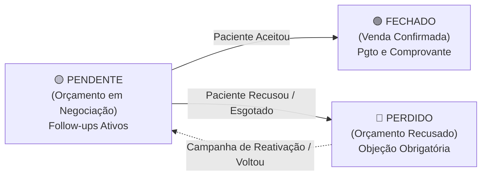

# PRD: CRM de Vendas e Orçamentos (Pipeline Kanban, Regras de Follow-up e Responsável Comercial)

Atualmente, o **MedGuia Hub** possui um fluxo comercial consolidado para registro de pacientes e formalização de vendas e orçamentos clínicos (`vendas`), suportando os status de `venda_confirmada`, `orcamento_pendente` e `orcamento_recusado`. No entanto, a gestão comercial e a recepção não dispõem de uma visualização visual e dinâmica em formato de **Pipeline / Kanban (CRM)** para acompanhar o ciclo de vida dessas oportunidades. Hoje, os orçamentos pendentes ficam dispersos na listagem tabular padrão de vendas, sem controle de tempo de estagnação, sem cadência ativa de contato e sem atribuição explícita de um responsável pelo fechamento comercial.

Na rotina clínica, quando um paciente realiza uma avaliação técnica com o fisioterapeuta ou recebe um plano de tratamento multidisciplinar, o plano frequentemente não é contratado no mesmo minuto. O paciente solicita tempo para "pensar", "conversar com o cônjuge" ou "verificar o orçamento mensal". Sem uma ferramenta dedicada de CRM, essas oportunidades pendentes esfriam rapidamente: a equipe esquece de retornar, não há registro histórico do que foi conversado em cada tentativa de contato, e os orçamentos perdidos nunca são reativados de forma estruturada.

Este documento define o **Módulo de CRM de Vendas e Orçamentos (V1)**, integrando um pipeline visual em 3 colunas canônicas (**Pendente**, **Fechado** e **Perdido**), uma régua automatizada de follow-up com alertas visuais de prazo e estagnação, atribuição nominal de **Responsável Comercial**, histórico cronológico de interações (com atalho dinâmico para WhatsApp) e métricas consolidadas de conversão do funil de vendas.

---

## Problema (O Porquê)

1. **Invisibilidade e Descentralização das Negociações em Aberto:**  
   A equipe comercial e a diretoria não têm uma tela onde possam bater o olho e ver: *"Quantos orçamentos estão em negociação agora?", "Qual o valor financeiro represado na mesa?"* e *"Quem é a pessoa da equipe cobrando cada proposta?"*. Na listagem tabular de `/vendas`, orçamentos pendentes misturam-se com vendas históricas já faturadas, dificultando a gestão proativa.

2. **Falta de Cadência e Regras Claras de Follow-up (Leads Esfriando):**  
   Um orçamento pendente não possui SLA de contato nem indicador de dias sem interação. Propostas de alto valor (ex.: planos de 10 a 20 sessões ou protocolos de reabilitação intensiva) ficam dias ou semanas sem que a recepção ou o closer envie uma mensagem ou ligue para tirar dúvidas, gerando perda silenciosa de faturamento.

3. **Ausência de Histórico de Interações por Oportunidade:**  
   Quando um colaborador entra em contato com o paciente por WhatsApp ou telefone, as informações trocadas ficam presas no celular pessoal ou na memória do operador. Se outro membro da equipe assumir o atendimento no dia seguinte, ele não sabe o que o paciente respondeu, se pediu desconto, se viajou ou se marcou retorno.

4. **Ambiguidade entre Profissional Clínico e Responsável Comercial:**  
   A tabela `vendas` registra apenas `profissional_id` (o fisioterapeuta ou médico que conduziu o atendimento clínico). Todavia, na operação real da clínica, quem executa o acompanhamento comercial (ligar, negociar condições de pagamento, enviar propostas revisadas e fechar) frequentemente é a secretária/recepcionista, um gestor comercial ou um consultor dedicado. Sem o campo de `responsavel_comercial_id`, não há prestação de contas (*accountability*) individual sobre o fechamento das propostas.

5. **Subaproveitamento dos Orçamentos Perdidos:**  
   Embora o sistema já possua a tabela `objecoes_orcamento`, quando um orçamento é recusado ele simplesmente "some" das prioridades operacionais. Não há uma coluna visual de oportunidades perdidas com possibilidade de repescagem/reengajamento programado (ex.: recontatar após 30 ou 60 dias com uma nova abordagem).

---

## Usuários (Para Quem)

- **Gestor Comercial / Diretor Clínico:**  
  *"Quero abrir o CRM todo início de manhã e ver exatamente quanto dinheiro está represado em propostas pendentes, quantos cards estão com follow-up atrasado, qual membro da equipe está com mais vendas travadas e qual é a nossa taxa de conversão semanal/mensal."*

- **Recepção / Closer / Consultor de Vendas:**  
  *"Preciso de um Kanban limpo onde meus cards pendentes fiquem organizados por prioridade e urgência. Quero clicar em um botão de WhatsApp com mensagem pronta, registrar em 10 segundos o que o paciente me respondeu e agendar a data do próximo contato para o sistema me lembrar."*

- **Fisioterapeuta / Avaliador:**  
  *"Quando eu gerar um orçamento na avaliação inicial, quero poder atribuir o card para a recepção fazer o follow-up ou mantê-lo sob minha responsabilidade caso eu queira fechar pessoalmente com o paciente, acompanhando se ele finalmente fechou o tratamento indicado."*

---

## Requisitos (O Quê)

---

### 1. Rota, Navegação e Visão Geral do CRM

#### 1.1. Rota Dedicada e Menu Lateral
- **Rota:** Criar a rota dedicada `/vendas/crm` (com atalho no menu lateral sob a seção **Comercial**, identificado pelo rótulo **CRM de Vendas** e ícone de funil/Kanban `KanbanSquare` ou `Trello`).
- **Permissão de Acesso:**
  - Cadastrado no catálogo de módulos (`src/lib/modulos.ts`) sob a chave `comercial:crm`.
  - Liberado nativamente para perfis `gestor`, `master` e usuários com a chave `comercial:crm` atribuída em seus acessos.

#### 1.2. Painel Superior de KPIs Executivos (Métricas Rápidas no Topo)
Logo acima do quadro Kanban, exibir cards compactos de resumo em tempo real do período filtrado:
- **Oportunidades em Aberto (Pendente):** Quantidade de propostas e montante financeiro total (ex.: `18 cards — R$ 34.800,00`).
- **Follow-ups Atrasados (Alerta Crítico):** Quantidade de cards pendentes sem interação há mais do que o prazo limite ou com data de retorno vencida (badge vermelho pulsante).
- **Vendas Ganhas no Período (Fechado):** Total de vendas convertidas (Qtd e R$).
- **Taxa de Conversão do Funil:** `(Total Fechado / (Total Fechado + Total Perdido)) * 100` expressa em percentual com indicador de tendência.
- **Ticket Médio das Oportunidades Ganhas:** Valor médio por venda convertida no período.

#### 1.3. Barra de Controles e Filtros Rápidos
- **Campo de Busca:** Filtro textual dinâmico em tempo real por nome do paciente, telefone ou nome do plano/produto.
- **Filtro por Responsável Comercial:** Dropdown com lista de colaboradores (`profiles`). Permite filtrar por:
  - *Todos os Responsáveis* (padrão para gestores).
  - *Minhas Oportunidades* (atalho rápido em 1 clique).
  - *Sem Responsável Atribuído* (para triagem imediata).
- **Filtro por Origem:** Filtrar por canal de aquisição (`Médico Consultório`, `Médico Conversão`, `Tráfego Pago`, `Indicação`, `Instagram`, etc.).
- **Filtro por Período de Criação:** Mês Atual, Últimos 7 dias, Últimos 30 dias, Personalizado.
- **Alternância de Visualização:** Toggle entre visualização em **Kanban (Quadro)** e **Lista (Tabela Analítica)**.

---

### 2. O Pipeline Kanban (As 3 Colunas Canônicas)

O fluxo comercial será estruturado inicialmente em 3 colunas canônicas bem definidas:



#### 2.1. Coluna 1: Pendente (Amarelo / Amber)
- **Status do Banco de Dados:** `orcamento_pendente`.
- **Identidade Visual:** Header com badge amarelo/dourado (`bg-amber-500/10 text-amber-600 border-amber-500/20`).
- **Objetivo:** Concentrar todas as negociações em curso. Todo orçamento recém-criado em `/vendas/nova` com status de orçamento pendente cai automaticamente nesta coluna.
- **Regras:**
  - Exibe contagem de cards e valor total acumulado no topo da coluna.
  - Cards ordenados prioritariamente por: **urgência de follow-up** (atrasados no topo, seguidos de vencem hoje, seguidos de futuros/em dia).

#### 2.2. Coluna 2: Fechado (Verde / Emerald)
- **Status do Banco de Dados:** `venda_confirmada`.
- **Identidade Visual:** Header com badge verde esmeralda (`bg-emerald-500/10 text-emerald-600 border-emerald-500/20`).
- **Objetivo:** Oportunidades convertidas com sucesso em receita para a clínica.
- **Transição de Entrada (Arrastar ou Botão "Converter em Venda"):**
  - Ao mover um card para a coluna **Fechado**, o sistema abre obrigatoriamente o **Modal de Formalização de Venda**:
    1. Validação/Confirmação da forma de pagamento (Pix, Cartão de Crédito, Débito, Dinheiro, Boleto ou Híbrido com número de parcelas).
    2. Upload obrigatório ou anexação de comprovante de pagamento (integrado ao Google Drive na pasta de comprovantes da clínica, respeitando as regras do sistema).
    3. Confirmação do valor final negociado (com ou sem desconto aprovado).
  - Após a confirmação, o registro na tabela `vendas` é atualizado para `venda_confirmada`.

#### 2.3. Coluna 3: Perdido (Vermelho / Rose)
- **Status do Banco de Dados:** `orcamento_recusado`.
- **Identidade Visual:** Header com badge vermelho/rosa (`bg-rose-500/10 text-rose-600 border-rose-500/20`).
- **Objetivo:** Oportunidades que não converteram no ciclo atual, registrando inteligência comercial sobre os motivos de desistência.
- **Transição de Entrada (Arrastar ou Botão "Marcar como Perdido"):**
  - Ao mover um card para a coluna **Perdido**, o sistema abre obrigatoriamente o **Modal de Registro de Perda**:
    1. **Motivo da Objeção:** Select obrigatório alimentado dinamicamente pela tabela `objecoes_orcamento` (ex.: *Preço alto, Vai pensar / decidir depois, Falta de tempo, Concorrente / Outra clínica, Motivo de saúde, Desistiu do tratamento*).
    2. **Observação do Desfecho:** Campo de texto livre para detalhes adicionais (ex.: *"Achou R$ 2.400 puxado para o momento; disse para tentar contato no próximo mês quando fecha a fatura do cartão"*).
    3. **Data Sugerida para Reengajamento (Opcional):** Permite programar um alerta futuro para a equipe de recuperação comercial reativar o lead.
- **Ação de Reativação:** Cards na coluna Perdido contam com botão de ação rápida `Reabrir Oportunidade`, retornando o card para a coluna **Pendente** e registrando o log de reabertura.

---

### 3. Anatomia do Card de Oportunidade no Kanban

Cada card dentro das colunas deve ser rico em contexto e permitir ações sem que o usuário precise abrir outra página:

```
+-------------------------------------------------------------+
| [Avatar] João da Silva (45 anos)          [Badge Follow-up] |
| 🏷️ Protocolo Coluna sem Dor (10 sessões)                    |
| 💰 R$ 2.800,00  •  3x Cartão                                |
| 👤 Responsável: Dra. Camila Santos                          |
| 📅 Criação: 14/09 (há 4 dias)                               |
| 💬 Último contato: "Pediu retorno na sexta" (ontem)         |
| ----------------------------------------------------------- |
| [ WhatsApp ]   [ + Interação ]   [ 👁️ Detalhes ]   [ ... ] |
+-------------------------------------------------------------+
```

#### 3.1. Informações Visíveis no Card
1. **Identificação do Paciente:**
   - Avatar do paciente (com fallback de foto via Google Drive ou iniciais coloridas via `AvatarPaciente`).
   - Nome completo clicável (atalho para a ficha do paciente em nova aba).
   - Telefone formatado com link direto.
2. **Dados da Oportunidade:**
   - Itens e serviços orçados (nome do produto/protocolo e quantidade de sessões).
   - **Valor Total (R$)** em tipografia destacada e negrito.
   - Origem do paciente (tag sutil: `Médico`, `Instagram`, `Indicação`, etc.).
3. **Responsável Comercial:**
   - Foto miniatura + primeiro nome do colaborador responsável pelo fechamento.
   - Possibilidade de trocar o responsável com 1 clique (popover rápido).
4. **Indicador Visual de Follow-up (Badge de SLA):**
   - 🟢 **Em Dia:** Próximo contato agendado para data futura.
   - 🟡 **Vence Hoje:** Contato agendado para o dia corrente.
   - 🔴 **Atrasado:** Data de contato ultrapassada ou sem interação há mais de X dias úteis.
   - ⚪ **Sem Agendamento:** Nenhuma data futura programada (alerta de atenção).
5. **Ações Rápidas no Rodapé do Card:**
   - **Botão WhatsApp:** Abre link `https://wa.me/55...` com template inteligente já preenchido.
   - **Botão Registrar Contato (`+ Interação`):** Abre modal enxuto para registrar ligação/mensagem e agendar o próximo retorno.
   - **Menu de Contexto (`...`):** Ver detalhes completos da venda, editar orçamento, transferir responsável, marcar como perdido ou excluir.

---

### 4. Regras e Mecanismo de Follow-up para Cards em "Pendente"

A essência do CRM para a clínica reside na disciplina e visibilidade do follow-up enquanto o card estiver no status **Pendente**:

#### 4.1. Régua de Cadência de Contato (SLA de Follow-up)
- Ao cadastrar um orçamento com status `orcamento_pendente`:
  - O sistema define automaticamente a **Primeira Data Sugerida de Follow-up** para **D+1** (próximo dia útil) caso o operador não informe uma data manual.
- **Régua Padrão Recomendada:**
  - **Tentativa 1 (D+1 pós-orçamento):** Alinhamento pós-consulta e envio do resumo do plano terapêutico.
  - **Tentativa 2 (D+3):** Quebra de objeções iniciais (condições de pagamento, dúvidas sobre horários).
  - **Tentativa 3 (D+7):** Chamada de decisão / vaga na agenda do fisioterapeuta.
  - **Tentativa 4 (D+15):** Última chamada amigável antes de arquivar ou classificar como Perdido.
- Se um card ficar mais de **48 horas** sem nenhuma interação registrada e sem data futura de contato, o badge visual muda automaticamente para **🔴 Sem Ação Recente**.

#### 4.2. Registro de Interações Comerciais (Histórico do Lead)
Ao clicar em `+ Interação` no card, o usuário registra o evento em menos de 15 segundos através do modal:
- **Canal Utilizado:** `WhatsApp`, `Ligação Telefônica`, `Mensagem Direta (Instagram)`, `Presencial / Balcão da Clínica`, `E-mail`.
- **Desfecho / Status do Contato:**
  - *Conversou com o paciente (Interesse mantido)*
  - *Pediu prazo / retorno em data específica*
  - *Pediu alteração de proposta ou desconto*
  - *Não atendeu / Caixa postal*
  - *Mensagem visualizada e não respondida*
  - *Sem resposta / Não entregue*
- **Anotação Resumida:** Campo de texto livre para registrar o que foi tratado (ex.: *"Paciente disse que recebe o salário no dia 20 e quer fechar em 4x no cartão"*).
- **Próxima Ação / Próximo Follow-up:**
  - **Data do Próximo Contato:** Campo de data com atalhos rápidos (`Amanhã`, `Em 3 dias`, `Próxima Segunda-feira`, `Personalizada`).
  - **Horário Preferencial:** Manhã, Tarde ou horário específico.
  - **Lembrete:** Caixa de texto curta com a pauta do retorno (ex.: *"Ligar para confirmar se o limite do cartão foi liberado"*).

#### 4.3. Integração Inteligente com WhatsApp (Templates com 1 Clique)
Ao clicar no ícone do WhatsApp no card do lead:
- O sistema gera a URL do WhatsApp Web / App (`wa.me`) utilizando o telefone do paciente limpo (sem máscara).
- O sistema preenche automaticamente um template contextualizado:
  > *"Olá, {primeiro_nome}! Aqui é a {nome_responsavel} da clínica MedGuia. Passando para saber como você está após sua avaliação com o(a) Dr(a). {nome_profissional} e se ficou com alguma dúvida sobre a proposta do seu {nome_protocolo_ou_servico}. Como podemos te ajudar a iniciar seu tratamento?"*
- Usuários podem personalizar os templates de follow-up nas configurações do sistema.

#### 4.4. Trava de Segurança e Prevenção de Abandono
- Cards pendentes há mais de **30 dias** consecutivos sem nenhuma movimentação ou interação entram em estado de **Estagnação Crítica**.
- O sistema sugere ao gestor através de um filtro rápido (`Estagnados > 30 dias`):
  - Enviar para a coluna **Perdido** com a objeção *"Tempo limite esgotado / Sem retorno do paciente"*.
  - Ou reatribuir o card para outro colaborador da equipe tentar uma nova abordagem de reativação.

---

### 5. Atribuição e Gestão de Responsável Comercial

#### 5.1. Distinção entre Profissional Clínico e Responsável Comercial
- **`profissional_id` (Existente na tabela `vendas`):** Identifica o profissional técnico (fisioterapeuta que realizou a avaliação ou médico referenciador). Permanece intocado para fins de cálculo de produtividade e comissão técnica.
- **`responsavel_comercial_id` (Novo campo na tabela `vendas`):** Identifica nominalmente o colaborador encarregado do fechamento comercial e da execução da régua de follow-up (`profiles.id`).

#### 5.2. Regras de Atribuição Padrão
- Ao criar um orçamento em `/vendas/nova`:
  - O campo **Responsável Comercial** vem pré-selecionado com o usuário atualmente logado.
  - Se o usuário for um fisioterapeuta, ele pode manter a si próprio como responsável ou selecionar um membro da recepção/comercial.
  - Se não for informado explicitamente, assume o usuário logado como fallback.

#### 5.3. Reatribuição Rápida e Filtros de Equipe
- **Reatribuição Individual:** No próprio card do Kanban, um botão simples de avatar permite selecionar outro membro da equipe com 1 clique (registrando no histórico: *"Responsável alterado de Maria para Lucas por Gestor"*).
- **Reatribuição em Lote (Gestores):** Gestores e Master podem selecionar múltiplos cards da coluna Pendente e reatribuí-los em massa (útil em casos de férias, licença ou redistribuição de carteira).
- **Visão Individual por Colaborador:** Cada operador pode clicar no filtro rápido *"Meus Cards"*, visualizando exclusivamente as oportunidades sob sua tutela, mantendo o foco operacional.

---

### 6. Modelo de Dados e Arquitetura Técnica

#### 6.1. Alterações na Tabela `public.vendas`
Adição de colunas estruturadas para suportar o CRM e o ciclo de follow-up:

```sql
-- Migration: crm_vendas_migration.sql

-- 1. Adicionar responsável comercial e campos de controle de follow-up em vendas
ALTER TABLE public.vendas
  ADD COLUMN IF NOT EXISTS responsavel_comercial_id uuid REFERENCES public.profiles(id) ON DELETE SET NULL,
  ADD COLUMN IF NOT EXISTS data_proximo_follow_up date,
  ADD COLUMN IF NOT EXISTS status_follow_up text NOT NULL DEFAULT 'em_dia' 
    CHECK (status_follow_up IN ('em_dia', 'vence_hoje', 'atrasado', 'sem_agendamento')),
  ADD COLUMN IF NOT EXISTS total_interacoes_crm integer NOT NULL DEFAULT 0,
  ADD COLUMN IF NOT EXISTS data_ultimo_contato_crm timestamptz,
  ADD COLUMN IF NOT EXISTS data_reabertura_crm timestamptz;

-- Comentários descritivos nas colunas
COMMENT ON COLUMN public.vendas.responsavel_comercial_id IS 'Usuário da equipe encarregado de acompanhar o fechamento comercial (closer/recepção).';
COMMENT ON COLUMN public.vendas.data_proximo_follow_up IS 'Data agendada para a próxima ação de contato com o paciente.';
COMMENT ON COLUMN public.vendas.status_follow_up IS 'Status calculado do follow-up: em_dia, vence_hoje, atrasado, sem_agendamento.';
COMMENT ON COLUMN public.vendas.total_interacoes_crm IS 'Contador desnormalizado de interações comerciais já registradas para este orçamento.';

-- 2. Índices de performance para consultas frequentes do Kanban
CREATE INDEX IF NOT EXISTS idx_vendas_crm_status_responsavel 
  ON public.vendas(status, responsavel_comercial_id) 
  WHERE status IN ('orcamento_pendente', 'venda_confirmada', 'orcamento_recusado');

CREATE INDEX IF NOT EXISTS idx_vendas_data_proximo_follow_up 
  ON public.vendas(data_proximo_follow_up) 
  WHERE status = 'orcamento_pendente';
```

#### 6.2. Nova Tabela: `public.venda_interacoes_crm`
Tabela dedicada para armazenar cada interação realizada pela equipe comercial:

```sql
CREATE TABLE IF NOT EXISTS public.venda_interacoes_crm (
  id uuid PRIMARY KEY DEFAULT gen_random_uuid(),
  venda_id uuid NOT NULL REFERENCES public.vendas(id) ON DELETE CASCADE,
  autor_id uuid NOT NULL REFERENCES public.profiles(id) ON DELETE RESTRICT,
  canal text NOT NULL CHECK (canal IN ('whatsapp', 'telefone', 'instagram', 'presencial', 'email', 'outro')),
  desfecho text NOT NULL CHECK (desfecho IN (
    'contato_sucesso',
    'pediu_prazo',
    'negociando_valores',
    'nao_atendeu',
    'sem_resposta',
    'recusou_proposta',
    'outro'
  )),
  descricao text NOT NULL,
  data_contato timestamptz NOT NULL DEFAULT now(),
  proxima_acao_data date,
  proxima_acao_lembrete text,
  created_at timestamptz NOT NULL DEFAULT now()
);

CREATE INDEX IF NOT EXISTS idx_venda_interacoes_venda_id 
  ON public.venda_interacoes_crm(venda_id, data_contato DESC);
```

#### 6.3. Gatilho (Trigger) para Atualização Automática de Métricas do Card
Sempre que uma nova interação for inserida em `venda_interacoes_crm`:
- Atualiza `total_interacoes_crm = total_interacoes_crm + 1`.
- Atualiza `data_ultimo_contato_crm = NEW.data_contato`.
- Se `NEW.proxima_acao_data` for preenchida, atualiza `data_proximo_follow_up = NEW.proxima_acao_data`.

```sql
CREATE OR REPLACE FUNCTION public.fn_atualizar_resumo_interacao_crm()
RETURNS trigger AS $$
BEGIN
  UPDATE public.vendas
  SET 
    total_interacoes_crm = total_interacoes_crm + 1,
    data_ultimo_contato_crm = NEW.data_contato,
    data_proximo_follow_up = COALESCE(NEW.proxima_acao_data, data_proximo_follow_up),
    atualizado_em = now()
  WHERE id = NEW.venda_id;
  RETURN NEW;
END;
$$ LANGUAGE plpgsql;

DROP TRIGGER IF EXISTS trg_atualizar_resumo_interacao_crm ON public.venda_interacoes_crm;
CREATE TRIGGER trg_atualizar_resumo_interacao_crm
  AFTER INSERT ON public.venda_interacoes_crm
  FOR EACH ROW
  EXECUTE FUNCTION public.fn_atualizar_resumo_interacao_crm();
```

---

### 7. Matriz de Permissões e Perfis

| Ação no CRM | Perfil Gestor / Master | Recepção / Comercial | Fisioterapeuta |
| :--- | :---: | :---: | :---: |
| Visualizar Pipeline Completo da Clínica | ✅ Sim (Total) | ✅ Sim (Total) | ⚠️ Opcional (Apenas suas avaliações ou Geral conforme permissão) |
| Visualizar "Minhas Oportunidades" | ✅ Sim | ✅ Sim | ✅ Sim |
| Criar Novo Orçamento / Card | ✅ Sim | ✅ Sim | ✅ Sim |
| Registrar Follow-up / Interação | ✅ Sim | ✅ Sim | ✅ Sim |
| Mover Card para Fechado (Confirmar Venda) | ✅ Sim | ✅ Sim | ✅ Sim (com validação de pagamento) |
| Mover Card para Perdido (Registrar Objeção) | ✅ Sim | ✅ Sim | ✅ Sim |
| Reatribuir Responsável do Card | ✅ Sim (Qualquer um) | ✅ Sim (Dentro da equipe) | ❌ Não (Apenas gestor ou criador) |
| Excluir Card / Oportunidade | ✅ Sim (Com log de auditoria) | ❌ Não | ❌ Não |
| Exportar Relatório do Funil de Conversão | ✅ Sim | ❌ Não | ❌ Não |

---

## Sugestões de Evoluções e Boas Práticas Recomendadas

1. **Atalhos Rápidos de Interação no Card:**  
   Em vez de exigir formulários longos, disponibilizar botões de "1 toque" para registros comuns: `Não Atendeu`, `Mensagem Enviada (WhatsApp)`, `Pediu Retorno`. Isso reduz o atrito e garante 100% de adesão pela equipe de recepção.

2. **Cálculo Automático de Status de SLA:**  
   Implementar função utilitária em TypeScript (`calcularStatusFollowUp(dataProximo, dataUltimo)`) que categorize em tempo real se o card está:
   - `atrasado`: quando a data do próximo follow-up for menor que hoje.
   - `vence_hoje`: quando a data do próximo follow-up for hoje.
   - `em_dia`: quando a data for futura.
   - `sem_agendamento`: quando não houver data agendada.

3. **Drag-and-Drop Fluido com Tratamento de Erro Otimista:**  
   O quadro Kanban deve utilizar interface drag-and-drop intuitiva com *optimistic updates*. Caso o usuário arraste para **Fechado** ou **Perdido**, o card abre o modal correspondente; se o usuário cancelar o modal, o card retorna suavemente para a coluna de origem sem persistir alteração no banco.

4. **Sincronização com o Módulo de Notificações / Badges no Header:**  
   Exibir no sino de notificações ou no menu lateral um badge numérico com a quantidade de **Follow-ups que vencem hoje ou estão atrasados**, incentivando a equipe a zerar as pendências diariamente (*Inbox Zero comercial*).

5. **Aba de Histórico na Ficha do Paciente (`/pacientes/[id]`):**  
   Adicionar na aba comercial do paciente uma linha do tempo unificada com todas as interações e propostas registradas pelo CRM, permitindo que qualquer profissional veja o histórico de negociações passadas antes de uma nova consulta.

---

## NUNCA PODE:

- **NUNCA PODE** permitir que uma oportunidade seja movida para a coluna **Perdido** sem a seleção expressa de um **Motivo de Objeção** cadastrado (garante inteligência de dados comerciais e consistência com `objecoes_orcamento`).
- **NUNCA PODE** confirmar uma venda (coluna **Fechado**) sem que a soma dos pagamentos declarados seja igual ao valor final da venda (tolerância máxima de R$ 0,01, conforme regra rígida de consistência financeira de `atualizarStatusVenda`).
- **NUNCA PODE** permitir que a exclusão de um colaborador (`profiles`) delete em cascata o histórico de vendas ou as interações comerciais registradas no CRM (deve manter `ON DELETE RESTRICT` ou preservar o histórico com `ON DELETE SET NULL`).
- **NUNCA PODE** misturar o conceito de `profissional_id` (prestador de saúde/avaliador) com `responsavel_comercial_id` (operador de vendas/closer); ambos devem coexistir de forma independente.
- **NUNCA PODE** bloquear o usuário caso ele queira registrar uma interação sem agendar um próximo follow-up (o agendamento é fortemente recomendado, mas não impeditivo para registrar fatos consumados).
- **NUNCA PODE** expor dados ou métricas financeiras globais do CRM para usuários cujo nível de acesso não possua autorização expressa para o módulo comercial.
- **NUNCA PODE** registrar interações em `venda_interacoes_crm` com datas no futuro (apenas o campo `proxima_acao_data` pode apontar para o futuro; o registro do contato representa um evento já ocorrido).
