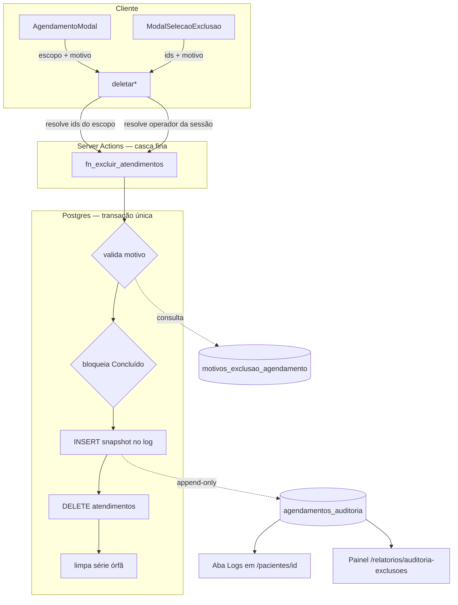

# TDD — Auditoria de Exclusão de Agendamentos

| Campo | Valor |
|-------|-------|
| **Tech Lead** | @Raniery |
| **Product Owner** | @Dr. Felipe |
| **Time** | Engenharia (MedGuia Hub) · Coordenação de Recepção (validação) |
| **Origem** | [PRD 003](../prds/003-sistema-de-logs-e-motivo-de-exclusao-de-agendamentos.md) · [RFC 003](../rfcs/003-auditoria-de-exclusao-de-agendamentos.md) (Opção 2) |
| **Precedente** | [RFC 002](../rfcs/002-ciclo-de-vida-dos-status-personalizados.md) — mesmo padrão de catálogo em tabela e trigger de integridade |
| **Status** | Draft — aguardando aprovação do RFC 003 |
| **Porte** | Médio (~7,5 dias) |
| **Tipo** | Feature + refactor de código de produção + dado sensível (saúde/LGPD) |
| **Criado** | 2026-08-25 |
| **Última atualização** | 2026-08-25 |

---

## Contexto

### Background

A exclusão de agendamentos no MedGuia Hub acontece hoje por quatro Server Actions em [`src/actions/agenda.ts`](../../src/actions/agenda.ts), todas com a mesma forma: autentica via `requirePermissaoAgendaAdmin()`, executa `DELETE` com o cliente `service role` e chama `revalidatePath()`. Nenhuma delas registra o que foi apagado. Como o `DELETE` é físico, o dado não sobrevive em lugar nenhum — nem no backup diário, que captura o estado *depois* da exclusão.

O RFC 003 decidiu mover a exclusão para uma função transacional no Postgres (Opção 2). Este TDD documenta **como** essa decisão vira código: o contrato da função, o esquema das tabelas, a refatoração das actions, as duas superfícies de leitura e o plano de aplicação.

### Domínio

Agenda clínica e auditoria. O dado manipulado inclui **informação de saúde** (tipo de procedimento, protocolo de atendimento, observações clínicas), o que coloca a entrega sob LGPD e torna a seção de Segurança obrigatória, não opcional.

### Stakeholders

| Quem | Interesse |
|------|-----------|
| Recepção | Fluxo diário de exclusão ganha um passo — precisa ser rápido |
| Gestão clínica | Trilha de auditoria e métrica de motivos de perda |
| Corpo clínico | Garantia de que consultas não somem da grade sem justificativa |
| Engenharia | Consolidar quatro caminhos de exclusão duplicados em um |

---

## Definição do Problema e Motivação

### Problemas que estamos resolvendo

**1. Exclusão anônima e sem justificativa**
Quando um atendimento some da agenda, não há registro de quem, quando ou por quê.
*Impacto:* toda investigação de "consulta sumida" vira conversa entre recepção e corpo clínico, sem fato reconstituível. O PRD lista redução desse tempo a zero como métrica.

**2. A proteção do histórico concluído só existe no navegador**
[`AgendamentoModal.tsx:415`](../../src/components/features/agenda/AgendamentoModal.tsx#L415) esconde o botão quando `isConcluido`. As quatro actions não checam status nenhum, e [`deletarTodasRecorrencias`](../../src/actions/agenda.ts#L1056) apaga por `agendamento_id` sem filtro — a série inteira, incluindo sessões já realizadas.
*Impacto:* perda irrecuperável de histórico clínico. É o defeito mais grave da entrega e a razão de ela não poder ser adiada.

**3. Ausência de dado estruturado sobre perdas**
Sem categoria de motivo, "quantos cancelamentos por questão financeira tivemos em julho?" não tem resposta.
*Impacto:* gestão de retenção opera por percepção.

### Por que agora

- O defeito 2 está ativo em produção e destrói dado clínico. O caminho de correção é exatamente o código que esta entrega reescreve — corrigir separado significa mexer nas mesmas quatro actions duas vezes.
- Cada semana sem log é uma semana **não auditável retroativamente**: o `DELETE` é físico e o dado não existe em backup.
- Base com 9.866 pacientes e histórico desde 2022.

### Impacto de não resolver

| Dimensão | Consequência |
|----------|--------------|
| Operacional | Atrito recorrente entre recepção e corpo clínico, sem árbitro factual |
| Clínico | Séries podem ser apagadas com sessões concluídas dentro |
| Gestão | Nenhuma métrica de motivo de perda; decisão de retenção sem dado |
| Compliance | Ação sobre dado de saúde sem trilha de auditoria |

---

## Escopo

### ✅ Dentro do escopo (V1)

- Tabela `agendamentos_auditoria` append-only, protegida por trigger.
- Tabela de catálogo `motivos_exclusao_agendamento`, seeded com a lista do PRD.
- Função transacional `fn_excluir_atendimentos` — validação, bloqueio de concluídos, snapshot, delete, limpeza de série órfã.
- Refatoração das quatro Server Actions de exclusão para casca fina sobre a RPC.
- Passo de motivo no modal, cobrindo os quatro escopos (avulso, pontual, série completa, lote).
- Aba **Logs** em `/pacientes/[id]`.
- Painel gerencial de auditoria em `/relatorios/auditoria-exclusoes`, com os quatro filtros do PRD.
- Bloqueio server-side de exclusão de atendimento `Concluído` (correção do defeito 2).

### ❌ Fora do escopo (V1)

- Soft delete / lixeira com restauração em um clique (definido no PRD; ver [RFC 003, Opção 3](../rfcs/003-auditoria-de-exclusao-de-agendamentos.md)).
- Auditoria de **edição** de agendamento (reagendamento, troca de profissional) e de cadastro do paciente.
- Notificação ao paciente no momento da exclusão.
- Exportação CSV do painel gerencial (Questão em Aberto 3 do RFC; +0,5d se entrar).
- Backfill retroativo — impossível: o dado das exclusões passadas não existe.

### 🔮 Futuro (V2+)

- `acao = 'edicao_*'` na mesma tabela — o esquema já comporta, sem migration nova.
- Retificação de log por registro novo (`acao = 'retificacao'`), nunca por edição.
- Restauração assistida a partir do snapshot, se a demanda aparecer (RFC, Suposição 3).

---

## Solução Técnica

### Visão de arquitetura

O princípio da entrega: **a regra de exclusão passa a viver num único lugar, e esse lugar é a transação do Postgres.**



**Responsabilidade de cada camada:**

| Camada | Responsabilidade | Por que aqui |
|--------|------------------|--------------|
| Modal | Coletar categoria + observação; bloquear confirmação até motivo válido | UX |
| Server Action | Autenticar, resolver o **operador** da sessão, resolver **quais ids** compõem o escopo | Já é onde essa lógica vive; é testável em TypeScript |
| `fn_excluir_atendimentos` | Validar, registrar e apagar — atomicamente | É a única camada com transação real |
| Trigger append-only | Impedir `UPDATE`/`DELETE` no log | Único ponto que o `service role` não contorna |

**Decisão-chave:** o cliente Supabase JS não abre transação. Qualquer gravação de log na Server Action seriam duas viagens ao banco, e uma falha entre elas produz exatamente o cenário que o PRD proíbe ("exclusão silenciosa"). Mover só a parte que precisa ser atômica para dentro do Postgres resolve isso sem migrar toda a lógica de agenda para SQL.

### Esquema de dados

**Tabela nova — `agendamentos_auditoria`** (append-only)

| Coluna | Tipo | Nulo | Descrição |
|--------|------|:----:|-----------|
| `id` | UUID PK | não | `gen_random_uuid()` |
| `criado_em` | TIMESTAMPTZ | não | `NOW()` — timestamp do evento |
| `acao` | TEXT | não | `exclusao_avulso` · `exclusao_sessao_recorrente` · `exclusao_serie_completa` · `exclusao_lote` |
| `motivo_categoria` | TEXT | não | slug validado contra o catálogo |
| `motivo_observacao` | TEXT | sim | obrigatória quando o catálogo exigir |
| `usuario_id` | UUID | **não** | operador — resolvido da sessão, nunca do payload |
| `usuario_nome` | TEXT | não | desnormalizado |
| `paciente_id` | UUID | sim | |
| `paciente_nome` | TEXT | não | desnormalizado |
| `profissional_id` | UUID | sim | |
| `profissional_nome` | TEXT | sim | |
| `atendimento_id` | UUID | não | id do registro apagado |
| `agendamento_id` | UUID | sim | série de origem, quando houver |
| `dados_agendamento` | JSONB | não | snapshot pré-exclusão |

**Restrição de integridade deliberada: nenhuma FK.** Uma FK para `atendimentos` só teria três comportamentos possíveis, e os três são piores que guardar o UUID cru:

| Comportamento | Efeito numa tabela de auditoria |
|---------------|--------------------------------|
| `ON DELETE CASCADE` | Apaga o log no instante em que ele passa a importar — é o que [`confirmacoes_auditoria`](../../database/confirmacoes_auditoria_migration.sql) faz hoje |
| `ON DELETE RESTRICT` | Impede a exclusão que estamos auditando |
| `ON DELETE SET NULL` | Destrói justamente o dado da auditoria |

O mesmo vale para `pacientes` e `profiles`: o nome vai desnormalizado em coluna própria **e** no snapshot, para o log sobreviver ao paciente ser arquivado ou ao profissional ser desligado.

**Snapshot — `dados_agendamento`**

Contrato do JSON, capturado dentro da transação com os dados ainda vivos:

```json
{
  "data_agendamento": "2026-09-03T14:00:00-03:00",
  "duracao_minutos": 50,
  "status": "Aguardando",
  "tipo": "Fisioterapia",
  "numero_sessao": 4,
  "total_sessoes": 12,
  "observacoes": "paciente prefere horário da tarde",
  "plano_saude": "Unimed",
  "criado_por": "uuid-do-criador",
  "created_at": "2026-08-01T09:12:00-03:00"
}
```

Os campos espelham o `select` de [`buscarDetalhesAgendamento`](../../src/actions/agenda.ts#L504-L525), que já é o contrato de leitura de agendamento no projeto. `numero_sessao`/`total_sessoes` são o que permite ao relatório distinguir **reposição** de **perda** — ver "Reposição de sessão pontual" abaixo.

**Índices**

| Índice | Serve a |
|--------|---------|
| `(paciente_id, criado_em DESC)` | Aba Logs do paciente |
| `(criado_em DESC)` | Painel gerencial, ordenação padrão |
| `(usuario_id)` | Filtro por operador |
| `(profissional_id)` | Filtro por profissional |
| `(motivo_categoria)` | Filtro por motivo e agregação de métrica |

**Tabela nova — `motivos_exclusao_agendamento`** (catálogo)

| Coluna | Tipo | Descrição |
|--------|------|-----------|
| `slug` | TEXT PK | identificador estável, referenciado pelo log |
| `label` | TEXT | texto exibido no modal |
| `exige_observacao` | BOOLEAN | valida no servidor |
| `ordem` | INT | ordenação no modal |
| `ativo` | BOOLEAN | permite aposentar motivo sem perder histórico |

Seed conforme o PRD: desistência pessoal, desistência financeira, erro de agendamento/duplicidade, indisponibilidade do profissional, alta médica, e `outros` com `exige_observacao = true`.

**Por que tabela e não enum/constante:** a taxonomia vai errar na primeira versão (RFC, Suposição 2 — confiança Média). Corrigi-la deve ser um `UPDATE`, não um deploy. Mesma decisão já validada em `status_disponibilidade_opcoes` no RFC 002. O `slug` é contrato: uma vez usado num log, nunca é renomeado — só desativado.

### Contrato da função transacional

```
fn_excluir_atendimentos(
  p_ids               UUID[],   -- alvos, já resolvidos pela action
  p_acao              TEXT,
  p_motivo_categoria  TEXT,
  p_motivo_observacao TEXT,
  p_usuario_id        UUID,
  p_usuario_nome      TEXT
) RETURNS TABLE (excluidos INT, serie_removida BOOLEAN)
```

`SECURITY DEFINER` com `SET search_path = public, pg_temp`.

**Sequência dentro da transação:**

| # | Passo | Falha resulta em |
|---|-------|------------------|
| 1 | `p_usuario_id` não nulo e existente em `profiles` | `RAISE` — exclusão anônima bloqueada (PRD "NUNCA PODE") |
| 2 | `p_motivo_categoria` existe no catálogo e está `ativo` | `RAISE` — motivo inválido |
| 3 | Se `exige_observacao`, `p_motivo_observacao` não vazia após `trim` | `RAISE` — justificativa obrigatória |
| 4 | Nenhum alvo com `status = 'Concluído'` | `RAISE` — aborta a operação **inteira**, não parcialmente |
| 5 | `INSERT ... SELECT` no log, com joins de paciente e profissional | rollback |
| 6 | `DELETE` dos atendimentos | rollback |
| 7 | Se a série ficou sem atendimentos, remove a linha órfã em `agendamentos` | rollback |

Qualquer `RAISE` desfaz tudo. **A atomicidade deixa de ser cuidado de implementação e passa a ser propriedade do banco** — é o ponto central do RFC.

O passo 4 é atômico por escopo de propósito: excluir um lote em que uma sessão está concluída falha por completo, em vez de apagar as outras e deixar o operador sem saber o que aconteceu. Ver Questão em Aberto 1 sobre o caminho alternativo ("somente pendentes").

### Contrato das Server Actions

As quatro assinaturas ganham um parâmetro de motivo:

```
deletarAgendamento(id, motivo)                       → acao = exclusao_avulso
deletarAtendimentoPontualDaRecorrencia(id, motivo)   → acao = exclusao_sessao_recorrente
deletarTodasRecorrencias(agendamentoId, motivo)      → acao = exclusao_serie_completa
deletarAtendimentosSelecionados(ids, agId, motivo)   → acao = exclusao_lote

motivo: { categoria: string; observacao?: string }
```

Cada uma passa a: autenticar → resolver `usuario_nome` do profile → resolver os ids do escopo → chamar a RPC → `revalidatePath`.

**O operador nunca vem do cliente.** `usuario_id` e `usuario_nome` são lidos do contexto de `requirePermissaoAgendaAdmin()`. Aceitá-los como parâmetro do componente permitiria forjar autoria — e o PRD trata isso como proibição explícita.

A mudança de assinatura **quebra o build** em qualquer chamador não migrado. Isso é o comportamento desejado: os únicos chamadores hoje são `AgendamentoModal` e `ModalSelecaoExclusao`, e uma quinta variante futura não compila sem motivo.

### Reposição de sessão pontual

[`deletarAtendimentoPontualDaRecorrencia`](../../src/actions/agenda.ts#L1001-L1049) hoje não apenas apaga: ela **insere uma sessão nova no fim da série** e atualiza `total_sessoes`. É reposição, não perda.

Decisão: **a reposição permanece na Server Action, depois da RPC confirmar.** Ela é regra de agenda, não de auditoria, e mantê-la em TypeScript preserva a lógica de `calcularProximaDataAgenda` onde ela é testável.

Consequência aceita: se a RPC tiver sucesso e a reposição falhar, a série fica uma sessão menor. **Isso já é o comportamento de hoje** — o `insert` atual é best-effort, sem rollback. A mudança é que agora a falha é logada e sinalizada na resposta, em vez de silenciosa.

O log distingue os dois casos por `acao` + `numero_sessao`/`total_sessoes` no snapshot, o que evita que o primeiro relatório de perdas conte reposições como cancelamentos.

### Superfícies de leitura

**Aba "Logs" em `/pacientes/[id]`**

[`PacienteTabsClient`](../../src/components/features/pacientes/PacienteTabsClient.tsx#L16) já tem sete abas com gate por módulo (`modulosLiberados`); adicionar é uma entrada no array `TABS` e um branch no render. A aba lista, em ordem cronológica decrescente: **quem excluiu · quando · escopo · motivo (categoria + observação) · dados da sessão apagada**.

É a superfície principal por um motivo além da conveniência: a pergunta operacional real não é "quantas exclusões tivemos" — é *"o que aconteceu com este paciente?"*. Responder isso ao lado do histórico de agendamentos é responder onde a pergunta nasce.

A aba também exibe a nota de que logs são imutáveis e corrigidos por registro novo — sem isso, o primeiro log errado vira chamado de suporte.

**Painel gerencial em `/relatorios/auditoria-exclusoes`**

Restrito a gestor (`isGestorSistema`, [`src/lib/permissoes.ts:8`](../../src/lib/permissoes.ts#L8)), seguindo o padrão das rotas irmãs em `/relatorios`. Filtros do PRD: período, profissional da agenda, operador, motivo. Paginação server-side sobre os índices acima.

---

## Considerações de Segurança

Obrigatória: o snapshot carrega **dado de saúde** (tipo de procedimento, protocolo, observações clínicas) e a entrega altera o caminho de escrita privilegiado do sistema.

### Autenticação e autorização

| Camada | Controle |
|--------|----------|
| Exclusão | `requirePermissaoAgendaAdmin()` — usuário ativo, módulo `agenda` ou gestor |
| Autoria | `usuario_id`/`usuario_nome` da sessão; a RPC recusa `usuario_id` nulo ou inexistente |
| Aba Logs | Mesmo gate de módulo das demais abas do paciente |
| Painel gerencial | `isGestorSistema` |

### `SECURITY DEFINER` — mitigação obrigatória

A função roda com os privilégios do owner. `SET search_path = public, pg_temp` é obrigatório na definição: sem isso, um schema malicioso no `search_path` do chamador pode sequestrar a resolução de nomes de tabela. É o vetor clássico de escalação em funções `DEFINER` e entra como item explícito de revisão do PR.

`EXECUTE` concedido apenas a `service_role` e `authenticated` — nunca a `anon`.

### Proteção do dado

| Aspecto | Decisão |
|---------|---------|
| Em trânsito | TLS, já vigente (`supabase.medguia.cloud`) |
| Em repouso | Criptografia de disco da VPS, já vigente |
| Imutabilidade | Trigger `BEFORE UPDATE OR DELETE` — **não** RLS |
| Leitura | RLS de `SELECT`; política pendente da Ação 3 do RFC |

**Por que trigger e não RLS para imutabilidade:** todas as exclusões passam por `supabaseAdmin` (service role), que **ignora RLS por definição**. Uma política `FOR UPDATE USING (false)` daria falsa segurança — o mesmo código que grava o log poderia reescrevê-lo. O trigger vale para service role, para o SQL Editor do Studio e para qualquer script.

### LGPD

| Requisito | Tratamento |
|-----------|------------|
| Base legal | Auditoria de prontuário/agenda — obrigação regulatória de guarda |
| Minimização | Snapshot limitado aos campos do contrato acima; sem CPF, sem telefone, sem e-mail |
| Retenção | Indefinida na V1 — é o propósito do log. **Pendência:** política de expurgo não definida (Questão em Aberto 5) |
| Acesso | Pendente da Ação 3 do RFC — **bloqueia a RLS da migration** |

### Nunca logar

- Dados de contato do paciente (telefone, e-mail) — desnecessários para auditoria de exclusão.
- Chaves, tokens ou o `SUPABASE_SERVICE_ROLE_KEY` em mensagens de erro da RPC.

---

## Riscos

| Risco | Impacto | Probabilidade | Mitigação |
|-------|:-------:|:-------------:|-----------|
| `SECURITY DEFINER` com `search_path` mutável | Alto | Baixa | `SET search_path = public, pg_temp`; item obrigatório de revisão no PR; asserção no teste de SQL |
| Snapshot com dado de saúde legível para todo autenticado | Alto | Média | RLS de SELECT definida **antes** do go-live (Ação 3 do RFC bloqueia a migration); painel restrito a gestor |
| Bloqueio de "Concluído" quebra fluxo real da recepção (limpeza de duplicidade) | Médio | Média | Validar com a recepção antes (Ação 2 do RFC); se for prática, entregar escopo "somente pendentes" explícito |
| Trigger append-only impede corrigir log gravado por engano | Médio | Alta | É o comportamento pedido pelo PRD. Correção por registro novo; comunicar na aba e no treinamento |
| Reposição da sessão pontual falha fora da transação | Médio | Baixa | Já é o comportamento atual; passa a ser logado e sinalizado na resposta |
| Migration exige SQL Editor do Studio (não sai via REST) | Médio | Alta | Procedimento padrão do projeto; roteiro escrito junto, no formato de [`ROTEIRO_APLICACAO_status_personalizados.md`](../../database/ROTEIRO_APLICACAO_status_personalizados.md) |
| Assinatura das actions muda e algum chamador fica para trás | Baixo | Baixa | TypeScript quebra o build; apenas dois chamadores hoje |
| Build derruba a VPS (histórico do projeto) | Médio | Média | Deploy fora do horário de pico, como nas entregas anteriores |
| Atrito na recepção com o passo extra | Médio | Média | Motivo em um toque; medir tempo real na primeira semana (métrica < 10s do PRD) |

---

## Estratégia de Testes

O projeto usa `node --test` com reporter TAP ([`onpspec.config.json`](../../onpspec.config.json)) e já tem a convenção de **testes de asserção estática sobre o texto das migrations** em [`test/sql/`](../../test/sql/) — eles não executam Postgres; garantem forma e ordem do SQL. É a mesma técnica usada para o fallback do RFC 002 e ela se aplica bem aqui.

| Tipo | Escopo | Onde |
|------|--------|------|
| Estático de SQL | Forma da migration e da função | `test/sql/auditoria-exclusao.test.ts` |
| Unitário | Resolução de ids por escopo; montagem do payload de motivo | `src/actions/*.test.ts` |
| UI | Estado do botão de confirmação; obrigatoriedade de observação | `test/ui/` |
| Manual em produção | Os 4 escopos + os 4 caminhos de recusa | Roteiro de validação |

### Cenários obrigatórios

**Asserções sobre o SQL**
- A tabela de auditoria **não** contém `REFERENCES` para `atendimentos`, `pacientes` ou `profiles`.
- Existe trigger `BEFORE UPDATE OR DELETE` na tabela de auditoria.
- A função declara `SET search_path`.
- O `INSERT` no log aparece **antes** do `DELETE` no corpo da função.

Essa última é a asserção que mais importa: a ordem é o que garante que o snapshot capture dados vivos, e é exatamente o tipo de detalhe que uma refatoração futura inverte sem perceber. Mesma classe de proteção que o teste de ordem do cron no RFC 002.

**Comportamento da função** (validação manual em staging/produção, contra Postgres real)

| Cenário | Esperado |
|---------|----------|
| Exclusão avulsa com motivo válido | 1 log, 1 atendimento removido |
| Motivo inexistente ou inativo | `RAISE`, nada removido, nenhum log |
| Categoria `outros` sem observação | `RAISE` |
| Categoria `outros` com observação só de espaços | `RAISE` |
| `usuario_id` nulo | `RAISE` |
| Lote com 1 alvo `Concluído` entre 5 pendentes | `RAISE`, **os 5 permanecem** |
| Série completa com sessões concluídas | `RAISE` — regressão do defeito 2 |
| Série completa sem concluídas | N logs, série e linha órfã em `agendamentos` removidas |
| Sessão pontual de recorrência | 1 log, sessão reposta no fim da série |
| `UPDATE` no log via service role | erro do trigger |
| `DELETE` no log via SQL Editor | erro do trigger |

As três últimas linhas de recusa e as duas do trigger são as que provam os "NUNCA PODE" do PRD. Devem estar no roteiro de validação assinado, não só na suíte.

---

## Monitoramento e Observabilidade

Não há APM no projeto; a observabilidade é o dashboard em `obs.medguia.cloud` e consultas SQL. As métricas abaixo são **consultas sobre a própria tabela de auditoria**, que é a fonte natural.

| Métrica | Consulta | Meta (PRD) | Frequência |
|---------|----------|------------|:----------:|
| Exclusões com log completo | logs com `usuario_id`, `criado_em` e `motivo_categoria` preenchidos | 100% | Semanal |
| Exclusões anônimas | logs com `usuario_id` nulo | 0 — impossível por schema (`NOT NULL`) | Semanal |
| Distribuição de motivos | `GROUP BY motivo_categoria` | `outros` < 20% | +30 dias |
| Volume de exclusões | contagem por semana | linha de base (Ação 1 do RFC) | Semanal |
| Recusas da RPC | `console.error` das actions | tendência decrescente após treinamento | Semanal |

**Log de aplicação:** as actions mantêm o padrão atual de `console.error` com código e mensagem do Postgres, acrescentando o escopo e a categoria de recusa. **Nunca** logar o conteúdo do snapshot — é dado de saúde.

**Sinal de que a entrega funcionou:** a métrica de "exclusões anônimas = 0" não é medida, é **garantida pelo schema** (`usuario_id NOT NULL` + validação na RPC). A medição serve para detectar um caminho de exclusão fora da RPC, não para verificar a regra.

**Alerta:** o projeto já tem alerta por WhatsApp via Evolution (instância `alertas-medguia`) usado pelo backup. Se aparecer exclusão fora da RPC — detectável por atendimento sumido sem log correspondente —, é o canal para avisar. Fora do escopo da V1; registrado como evolução.

---

## Plano de Rollback

### Estratégia de deploy

Sem feature flag. A entrega é uma mudança de contrato: a assinatura das actions muda e a RPC passa a ser o único caminho. Um flag exigiria manter os dois caminhos vivos — inclusive o que apaga sem log, que é justamente o que estamos removendo.

Deploy único, fora do horário de pico, na ordem:

1. Migrations (tabelas, catálogo, trigger, função) — **aditivas**, não tocam `atendimentos`.
2. Deploy da aplicação (actions + modal + abas).

Entre (1) e (2) o sistema continua funcionando com o comportamento antigo: as tabelas novas ficam vazias e a função sem chamador. **A janela é segura.**

### Gatilhos de rollback

| Gatilho | Ação |
|---------|------|
| Recepção não consegue excluir agendamento legítimo | Rollback da aplicação; investigar |
| RPC recusando exclusões válidas | Rollback da aplicação |
| Erro de permissão na função em produção | Rollback da aplicação; revisar `GRANT` |
| Log gravando dado errado (paciente/operador trocado) | **Rollback imediato** — log errado é pior que log ausente |

### Passos

**Aplicação:** reverter o deploy para o commit anterior. As actions voltam à assinatura antiga e o comportamento antigo (exclusão sem log) retorna.

**Banco:** as migrations **não são revertidas**. As tabelas ficam órfãs e inertes; a função fica sem chamador. Nenhuma delas altera `atendimentos`, então não há o que restaurar.

**Os logs já gravados permanecem** — e é isso que se quer: o trigger append-only impede apagá-los, inclusive num rollback. Um rollback que apagasse a auditoria já coletada derrotaria o propósito da entrega.

**Backup:** a rotina diária de 3h ([`BACKUP_SUPABASE.md`](../BACKUP_SUPABASE.md)) cobre o dia anterior. Snapshot manual antes de aplicar as migrations, por procedimento.

### Pós-rollback

Análise de causa em 24h, correção com teste que cubra o cenário, e novo deploy pelo mesmo caminho.

---

## Plano de Implementação

| Fase | Tarefa | Estimativa | Depende de |
|------|--------|:----------:|-----------|
| **1 — Banco** | Migration: `agendamentos_auditoria` + índices + RLS + trigger append-only | 0,5d | Ação 3 do RFC (política de leitura) |
| | Migration: `motivos_exclusao_agendamento` + seed do PRD | 0,5d | — |
| | `fn_excluir_atendimentos` — validações, bloqueio de concluídos, snapshot, delete, limpeza de série | 1,5d | migrations acima |
| | Testes estáticos de SQL | incluso | função escrita |
| **2 — Actions** | Refatorar as 4 actions para casca fina sobre a RPC | 1d | fase 1 |
| | Resolver `usuario_nome` do profile; tratar recusas da RPC | incluso | |
| **3 — UI de escrita** | Passo de motivo no `AgendamentoModal` (3 escopos) | 1d | fase 2 |
| | Passo de motivo no `ModalSelecaoExclusao` (lote) + aviso reforçado de série | 0,5d | fase 2 |
| **4 — UI de leitura** | Aba "Logs" em `/pacientes/[id]` | 1d | fase 2 |
| | Painel `/relatorios/auditoria-exclusoes` com 4 filtros | 1d | fase 2 |
| **5 — Entrega** | Roteiro de aplicação + validação em produção + comunicação à recepção | 0,5d | tudo |
| | **Total** | **~7,5d** | |

**Caminho crítico:** fase 1 → fase 2 → (fases 3 e 4 em paralelo) → fase 5.

**Bloqueios externos** (do RFC, ambos pré-implementação):
- **Ação 2** — a recepção usa "excluir série" para limpar duplicidades? Define se o bloqueio de concluídos é seco ou precisa do escopo "somente pendentes". Bloqueia a fase 1.
- **Ação 3** — política de leitura do snapshot. Bloqueia a RLS da fase 1.

---

## Métricas de Sucesso

| Métrica | Linha de base | Meta | Como medir |
|---------|---------------|------|------------|
| Exclusões com log completo | 0% | 100% | Consulta na tabela de auditoria |
| Exclusões anônimas | desconhecido (não rastreado) | 0 | Garantido por schema; consulta confirma |
| Tempo de preenchimento do modal | N/A | < 10s | Observação com a recepção na 1ª semana |
| Exclusão de sessão `Concluído` | possível hoje | impossível | Cenário de teste + tentativa manual |
| Tempo da gestão investigando "consulta sumida" | horas/conversas | ~0 | Feedback da coordenação em +30d |
| Uso de `outros` como motivo | N/A | < 20% | `GROUP BY` em +30d (RFC, Suposição 2) |

---

## Glossário

| Termo | Significado |
|-------|-------------|
| **Escopo de exclusão** | Qual conjunto some: avulso, sessão pontual de série, série completa, lote selecionado |
| **Reposição** | Sessão nova inserida no fim da série ao excluir uma sessão pontual — a série não encurta |
| **Snapshot** | Cópia JSON dos dados do atendimento tirada antes do `DELETE` |
| **Append-only** | Só aceita `INSERT`; `UPDATE` e `DELETE` são recusados pelo trigger |
| **Service role** | Chave privilegiada do Supabase que ignora RLS — usada por todas as actions de agenda |
| **`SECURITY DEFINER`** | Função Postgres que roda com privilégios do owner, não do chamador |
| **Série órfã** | Linha em `agendamentos` sem nenhum atendimento vinculado |
| **RPC** | Chamada de função Postgres via `supabase.rpc()` |

---

## Dependências

| Dependência | Tipo | Estado | Risco |
|-------------|------|--------|-------|
| Aprovação do RFC 003 | Decisão | Pendente | **Bloqueia tudo** |
| Ação 2 do RFC — validação com a recepção | Decisão | Pendente | Bloqueia fase 1 |
| Ação 3 do RFC — política de leitura (LGPD) | Decisão | Pendente | Bloqueia RLS da fase 1 |
| SQL Editor do Studio | Infra | Disponível | Baixo — procedimento padrão |
| Backup diário 3h | Infra | Ativo desde 17/08/2026 | Baixo |
| `requirePermissaoAgendaAdmin` | Interno | Em produção | Baixo — sem mudança |
| `PacienteTabsClient` | Interno | Em produção | Baixo — padrão de aba estabelecido |

---

## Alternativas Consideradas

Avaliadas e decididas no [RFC 003](../rfcs/003-auditoria-de-exclusao-de-agendamentos.md). Resumo:

| Alternativa | Por que não |
|-------------|-------------|
| Log na Server Action | Sem transação — falha entre `INSERT` e `DELETE` produz a "exclusão silenciosa" que o PRD proíbe. Regra replicada em 4 lugares |
| Soft delete (`excluido_em`) | Exige filtrar **toda** leitura de `atendimentos` no projeto; a linha continua editável, então não é append-only. Contraria o "Fora do Escopo" do PRD |
| Não fazer nada | Defeito do histórico concluído segue ativo; exclusões passadas seguem irrecuperáveis |

---

## Questões em Aberto

| # | Questão | Contexto | Owner | Estado |
|---|---------|----------|-------|--------|
| 1 | Bloqueio de "Concluído" é absoluto, ou existe escopo "somente pendentes"? | Se a recepção usa exclusão de série para limpar duplicidade, o bloqueio seco cria beco sem saída. `buscarAtendimentosPendentesRecorrencia` já implementa o filtro para o lote | @Dr. Felipe + Coordenação | 🔴 Bloqueia fase 1 |
| 2 | Quem enxerga a aba "Logs" no paciente? | Recomendação: quem já vê o histórico — é a mesma classe de informação, e restringir esvazia o valor operacional | @Dr. Felipe | 🔴 Bloqueia RLS |
| 3 | Exportação CSV no painel gerencial? | Não está no PRD | @Dr. Felipe | 🟡 Fora do escopo por padrão; +0,5d |
| 4 | Auditoria de **edição** entra em V2 na mesma tabela? | A coluna `acao` já comporta `edicao_*` sem migration nova | Engenharia | 🟡 Registrado para não refazer o schema |
| 5 | Política de expurgo/retenção do log | Retenção indefinida na V1. LGPD pede prazo definido para dado de saúde | @Dr. Felipe + Gestão | 🔴 Aberta — decidir até +90d |

---

## Aprovação

| Papel | Nome | Estado |
|-------|------|--------|
| Aprovação do RFC 003 | @Dr. Felipe | ⏳ Pendente |
| Tech Lead | @Raniery | ⏳ Aguarda RFC |
| Política de leitura do snapshot (LGPD) | @Dr. Felipe + Gestão | 🔴 Não iniciada |
| Validação do fluxo com a recepção | Coordenação | 🔴 Não iniciada |

**Critérios para começar a implementação:**
- [ ] RFC 003 aprovado
- [ ] Questão 1 respondida (define o comportamento da RPC)
- [ ] Questão 2 respondida (define a RLS)
- [ ] Snapshot manual do banco antes das migrations
