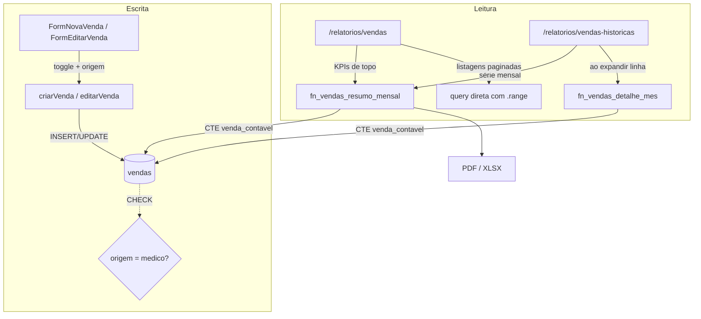

# TDD — Atribuição Comercial (Consultório vs. Conversão Fisio) e Relatório de Vendas Históricas

| Campo | Valor |
|-------|-------|
| **Tech Lead** | @Raniery |
| **Product Owner** | @Dr. Felipe |
| **Time** | Engenharia (MedGuia Hub) · Gestão Comercial · Coordenação de Recepção (validação) |
| **Origem** | [PRD 004](../prds/004-venda-em-consultorio-e-relatorio-historico-de-vendas.md) · [RFC 004](../rfcs/004-venda-em-consultorio-e-relatorio-historico-de-vendas.md) (Opção 2) |
| **Precedente** | [TDD 003](003-auditoria-de-exclusao-de-agendamentos.md) — mesmo padrão de função `SECURITY DEFINER` como ponto único de regra |
| **Status** | Draft — questões bloqueantes resolvidas; pronto para aprovação |
| **Porte** | Médio-grande (~9,5 dias) |
| **Tipo** | Feature + refactor de código de produção usado diariamente |
| **Criado** | 2026-08-27 |
| **Última atualização** | 2026-08-27 |

> **As duas questões bloqueantes estão fechadas** (27/08/2026). Legado fica `NULL` (Questão 1). Venda confirmada sem itens conta como R$ 0,00 (Questão 2) — e a medição mostrou que **não existe nenhuma na base**, então a correção não muda nenhum número em produção. Nenhuma fase está travada.

---

## Contexto

### Background

O módulo de vendas do MedGuia Hub registra a origem de cada venda em `vendas.origem` (texto livre validado na Server Action) e, quando a origem é `medico`, guarda `medico_referenciador_id` mais o nome desnormalizado em `medico_referenciador_nome`. Toda venda de origem médica é, hoje, uma linha só: não existe distinção entre o médico que fecha o tratamento dentro do próprio consultório e o médico que apenas encaminha o contato para a clínica.

A leitura desse dado acontece em [`/relatorios/vendas`](../../src/app/(painel)/relatorios/vendas/page.tsx), um Server Component de 1.047 linhas que faz **uma** query com quatro joins aninhados e agrega tudo em memória num laço de ~120 linhas. Funciona porque o filtro padrão é de um mês. O PRD 004 pede 36 meses com meta de 1,5s.

O RFC 004 decidiu mover a agregação para o Postgres (Opção 2), com uma definição canônica única de "venda contável" compartilhada pelos dois relatórios. Este TDD documenta **como** essa decisão vira código: o contrato das funções, o esquema da coluna nova, a refatoração das actions e da rota existente, a rota nova e o plano de aplicação.

### Domínio

Gestão comercial e analítica de faturamento. O dado manipulado é **financeiro e de desempenho individual** (faturamento por profissional, atribuição de conversão por fisioterapeuta, retorno por médico parceiro) — não é dado de saúde, o que mantém a entrega fora do escopo direto de LGPD sensível, mas a exposição por perfil continua importando: um fisioterapeuta não deve ler o faturamento consolidado da clínica.

### Stakeholders

| Quem | Interesse |
|------|-----------|
| Gestão / Diretoria | Evolução histórica de faturamento e ticket médio; quanto do volume veio pronto do consultório |
| Fisioterapeutas | Reconhecimento justo da conversão ativa vs. atendimento de venda já fechada |
| Recepção | O toggle entra no fluxo de cadastro diário — precisa ser um clique, não um passo |
| Médicos parceiros | Indiretamente: a análise de retorno da parceria passa a distinguir convertedor de indicador |
| Engenharia | Eliminar o teto silencioso do PostgREST e a duplicação da regra de agregação |

---

## Definição do Problema e Motivação

### Problemas que estamos resolvendo

**1. Não há atribuição comercial no canal médico**
Toda venda com `origem = 'medico'` é homogênea. O fisioterapeuta que converteu uma indicação difícil aparece igual ao que recebeu o paciente com o plano pronto.
*Impacto:* comissão, avaliação de desempenho e decisão sobre quais parcerias médicas manter são tomadas hoje sem esse dado. E o dado **não é reconstituível retroativamente** — só passa a existir a partir do momento em que o toggle existe.

**2. Não há visão histórica**
A pergunta "como evoluiu nosso faturamento nos últimos 12 meses" se responde hoje rodando o relatório mês a mês, manualmente, e anotando os números fora do sistema.
*Impacto:* apuração mensal em planilha paralela, sem rastreabilidade e sem garantia de que bate com o sistema.

**3. O relatório atual tem um teto silencioso**
A query de [`page.tsx:126-146`](../../src/app/(painel)/relatorios/vendas/page.tsx#L126-L146) não usa `.range()` nem `limit`. O `db-max-rows` do PostgREST trunca a resposta **sem erro** e sem que nada no código compare `count` com o tamanho do array.
*Impacto:* o modo de falha não é "relatório lento" — é **relatório com número errado, sem aviso**. Latente hoje porque ninguém filtra períodos longos; o PRD 004 é exatamente o que vai fazer alguém filtrar períodos longos.

**4. Uma "NUNCA PODE" do PRD é contrariada pelo código atual — mas sem efeito prático**
[`page.tsx:211`](../../src/app/(painel)/relatorios/vendas/page.tsx#L211) faz `if (itens.length === 0) continue`: uma venda confirmada sem itens seria descartada do faturamento **e do denominador do ticket médio**.
*Impacto medido (27/08/2026):* **nenhum.** A base não tem uma única venda sem itens, em nenhum status — o `continue` nunca disparou por esse motivo. O problema era real em teoria e inexistente na prática. Registrado aqui porque a CTE canônica precisa decidir a regra de qualquer forma, e porque a medição é o que autoriza a entrega a não se preocupar com isso.

### Por que agora

- O toggle só produz dado a partir do momento em que existe, e edição retroativa em lote está **fora do escopo do PRD**. Cada semana sem ele é uma semana de vendas médicas permanentemente não classificadas.
- O relatório histórico e a segmentação do relatório atual dependem da **mesma** definição de venda contável. Fazer os dois com a mesma regra custa uma vez; descobrir depois que divergem custa a confiança nos dois.
- O teto do PostgREST vira defeito visível no dia em que a rota histórica existir.

### Impacto de não resolver

| Dimensão | Consequência |
|----------|--------------|
| Comercial | Atribuição de conversão permanece anedótica; comissão decidida por percepção |
| Gestão | Apuração mensal segue manual, em planilha fora do sistema |
| Técnico | Truncamento silencioso permanece latente, esperando o primeiro filtro longo |
| Confiança | Ticket médio atual continua com viés não documentado |

---

## Escopo

### ✅ Dentro do escopo (V1)

**Atribuição comercial**
- Coluna `venda_em_consultorio` em `vendas`, com `CHECK` amarrando-a à origem médica.
- Toggle na Aba 1 de [`FormNovaVenda`](../../src/components/features/vendas/FormNovaVenda.tsx) e [`FormEditarVenda`](../../src/components/features/vendas/FormEditarVenda.tsx), condicionado a `origem === 'medico'`.
- Validação nas Server Actions `criarVenda` e `editarVenda`, incluindo limpeza do valor ao trocar de origem.

**Camada canônica de agregação**
- `fn_vendas_resumo_mensal` — uma linha por mês, com a CTE que define "venda contável".
- `fn_vendas_detalhe_mes` — drill-down sob demanda de um único mês.

**Relatório histórico (rota nova)**
- `/relatorios/vendas-historicas`: cards executivos, gráfico com alternância de métrica, tabela mês a mês com MoM e drill-down expansível, filtros globais.
- Exportação PDF e XLSX.
- Entrada no [`Sidebar`](../../src/components/layout/Sidebar.tsx#L308), no grupo Comercial.

**Segmentação no relatório existente**
- Filtro de modalidade de fechamento, cards comparativos, colunas nas tabelas de médico e de profissional, tag na listagem detalhada.
- Bloco correspondente no [`pdf-vendas.ts`](../../src/lib/relatorios/pdf-vendas.ts).

**Refactor de consistência** *(decidido: entra nesta entrega)*
- KPIs de topo de `/relatorios/vendas` passam a vir de `fn_vendas_resumo_mensal`, com validação lado a lado antes do corte.

### ❌ Fora do escopo (V1)

- **Card/gráfico de vendas no dashboard** — o PRD o trata como existente; ele **não existe** ([`dashboard/page.tsx`](../../src/app/(painel)/dashboard/page.tsx) tem zero ocorrências de `vendas`). Decidido: fora. Barato de adicionar depois, porque a função já devolve a série mensal pronta.
- Cálculo automatizado de comissão / repasse para folha (PRD, Fora do Escopo).
- Forecast preditivo por IA (PRD, V2).
- Edição retroativa em lote para marcar consultório em massa (PRD, V2).
- Materialização do resumo mensal (Opção 3 do RFC) — reavaliada aos 30 dias com dado real.
- Auditoria de alteração do próprio toggle (quem mudou de `true` para `false` e quando).

### 🔮 Futuro (V2+)

- Tabela materializada `vendas_resumo_mensal` se a medição pós-go-live mostrar necessidade. A função canônica já define exatamente o que materializar.
- Card de vendas no dashboard, consumindo a mesma função.
- Filtro por modalidade também no relatório histórico, se a gestão pedir.

---

## Solução Técnica

### Princípio da entrega

**A definição de "venda contável" passa a viver num único lugar, e esse lugar é uma CTE dentro de uma função no Postgres.** Tudo o mais decorre disso: a consistência entre relatórios deixa de ser disciplina de quem escreve a página e vira propriedade do sistema.



O bloco cinza importa: `fn_vendas_resumo_mensal` e `fn_vendas_detalhe_mes` compartilham a **mesma** definição de venda contável. As listagens detalhadas continuam saindo de query direta, porque são naturalmente paginadas — mas passam a usar `.range()` explícito.

---

### Mudanças no banco

#### Coluna `venda_em_consultorio`

```
vendas.venda_em_consultorio   BOOLEAN   NULL
```

Três estados, deliberadamente:

| Valor | Significado | Origem |
|-------|-------------|--------|
| `NULL` | Não informado | Vendas anteriores à entrega; vendas de origem não-médica |
| `true` | Fechada no consultório pelo médico | Operador marcou o toggle |
| `false` | Convertida pelo fisioterapeuta | Default da UI, escolha consciente ao deixar desmarcado |

**Divergência deliberada do PRD**, que pediu `NOT NULL DEFAULT false`. A razão é a assimetria de custo do erro: converter `NULL → false` depois é um `UPDATE` de uma linha; separar `false` em "não informado" e "convertida pelo fisio" depois é **impossível** — a informação nunca existiu, e edição em lote está fora do escopo.

Há um segundo motivo, que o RFC não explicita: a métrica central do PRD é *"100% das vendas médicas classificadas"*. Com `false` no legado, essa métrica nasce em 100% no dia 1 e é falsa. Com `NULL`, ela nasce baixa e sobe conforme a recepção adota o toggle — que é exatamente o que a Ação 13 do RFC quer medir aos 30 dias. `false` não só distorce o histórico: **inutiliza o instrumento de medir a adoção.**

> **Decidido em 27/08/2026 (Questão 1): `NULL`.** A gestão confirmou que o relatório histórico existe justamente para consultar meses anteriores ao deploy — que são, hoje, quase todo o período disponível. Com `NOT NULL DEFAULT false`, a primeira tela aberta atribuiria 100% do faturamento médico desses meses a "Convertido pelo Fisio": falso, visível de imediato e indistinguível depois. A rota nasceria mentindo exatamente na coluna que ela existe para mostrar.

#### Restrições e índices

```
CONSTRAINT vendas_consultorio_apenas_origem_medico
  CHECK (venda_em_consultorio IS NULL OR origem = 'medico')

INDEX idx_vendas_data_status        ON vendas (data_venda, status)
INDEX idx_vendas_medico_ref_id      ON vendas (medico_referenciador_id) WHERE medico_referenciador_id IS NOT NULL
```

O `CHECK` é a peça que atende o requisito de restrição no servidor. Hoje a regra equivalente ("médico referenciador obrigatório quando origem = medico") existe **só nas Server Actions**, duplicada em [`vendas.ts:133`](../../src/actions/vendas.ts#L133) e [`vendas.ts:282`](../../src/actions/vendas.ts#L282). Esse é o padrão que o achado 1 do RFC 003 já mostrou falhar: regra replicada em duas actions nasce dessincronizada na terceira. Aqui a action continua validando — para devolver mensagem amigável — mas deixa de ser a única linha de defesa. Nenhum script, correção manual ou action futura consegue marcar consultório fora da origem médica.

O índice sobre `medico_referenciador_id` sustenta a mudança de filtro por nome para filtro por id (ver [Filtros](#filtros-globais)).

Migration aditiva, no padrão do projeto (`ADD COLUMN IF NOT EXISTS`), aplicada pelo SQL Editor do Studio como nas entregas anteriores. A coluna nasce `NULL` em todas as linhas, então o `CHECK` não pode falhar na aplicação — verificado mesmo assim no roteiro.

---

### A CTE canônica: o que é uma "venda contável"

Esta é a peça central da entrega. A definição, compartilhada pelas duas funções:

| Regra | Decisão | Justificativa |
|-------|---------|---------------|
| Status | Apenas `venda_confirmada` entra no faturamento realizado | Comportamento atual ([L242-251](../../src/app/(painel)/relatorios/vendas/page.tsx#L242-L251)) e "NUNCA PODE" do PRD |
| Orçamentos | `orcamento_pendente` e `orcamento_recusado` contados **à parte**, em colunas próprias | Alimentam o funil sem contaminar o faturamento |
| Faturamento da venda | `SUM(itens_venda.quantidade × preco_unitario)` | Igual ao cálculo atual |
| **Venda confirmada sem itens** | **Conta como venda de R$ 0,00** — entra no denominador do ticket médio | Ver abaixo |
| Data de referência | `data_venda`, truncada ao mês | — |
| Mês sem venda | Aparece com faturamento zero, MoM `—` | Divisão por zero não é `-100%` |

**Sobre a venda sem itens — medido em 27/08/2026, e o resultado dissolve o problema.**

O código atual descarta a venda inteira. Descartar do *numerador* é defensável (R$ 0 não soma faturamento de qualquer jeito); descartar do *denominador* não é — produz uma métrica que exclui os próprios casos ruins. A CTE conta.

O diagnóstico ([`diagnostico_vendas_sem_itens.sql`](../../database/diagnostico_vendas_sem_itens.sql)) mostrou que **a base não tem nenhuma venda sem itens, em nenhum status**:

| Status | Total | Sem itens |
|--------|:-----:|:---------:|
| `venda_confirmada` | 179 | **0** |
| `orcamento_pendente` | 53 | **0** |
| `orcamento_recusado` | 3 | **0** |

Ticket médio pela regra atual: **R$ 2.286,37**. Pela CTE canônica: **R$ 2.286,37**. Variação: **0,00%**.

Duas consequências:

1. **Nenhum número muda em produção.** O risco de comunicação prévia à gestão, que era o mais grave desta entrega, **deixa de existir**. Ver [Riscos](#riscos).
2. **O `continue` de [`page.tsx:211`](../../src/app/(painel)/relatorios/vendas/page.tsx#L211) nunca disparou** por venda sem itens. Não é regra de negócio deliberada — é defesa preventiva nunca exercitada. A CTE não está corrigindo um comportamento divergente; está apenas não replicando um caso que não ocorre.

Fica um resíduo, registrado como Questão 6: se o fluxo de cadastro **pode** produzir venda confirmada sem itens, o lugar de impedir isso é `criarVenda`/`editarVenda` ou uma constraint, não o relatório. Não bloqueia esta entrega.

---

### Contrato das funções

Ambas em `SECURITY DEFINER` com `SET search_path = public, pg_temp` — obrigatório, pelo mesmo motivo documentado no [TDD 003](003-auditoria-de-exclusao-de-agendamentos.md): sem isso, um schema malicioso no `search_path` do chamador sequestra a resolução de nomes dentro da função. Revisão explícita no PR.

#### `fn_vendas_resumo_mensal`

**Parâmetros**

| Parâmetro | Tipo | Default | Papel |
|-----------|------|---------|-------|
| `p_data_inicio` | `DATE` | — | Início do período |
| `p_data_fim` | `DATE` | — | Fim do período |
| `p_profissional_id` | `UUID` | `NULL` | Filtro por fisioterapeuta |
| `p_medico_id` | `UUID` | `NULL` | Filtro por médico referenciador (**por id**) |
| `p_origem` | `TEXT` | `NULL` | Filtro por canal |
| `p_categoria` | `TEXT` | `NULL` | Tratamentos vs. consultas |
| `p_modalidade` | `TEXT` | `NULL` | `consultorio` / `fisio` / `nao_classificada` |

**Retorno — uma linha por mês do período**

| Coluna | Tipo | Observação |
|--------|------|------------|
| `mes` | `DATE` | Primeiro dia do mês |
| `faturamento` | `NUMERIC` | Vendas confirmadas |
| `qtd_vendas` | `INT` | Denominador do ticket médio |
| `ticket_medio` | `NUMERIC` | `faturamento / qtd_vendas`, `0` quando não há vendas |
| `faturamento_consultorio` | `NUMERIC` | `venda_em_consultorio = true` |
| `qtd_consultorio` | `INT` | |
| `faturamento_fisio` | `NUMERIC` | `venda_em_consultorio = false` |
| `qtd_fisio` | `INT` | |
| `qtd_nao_classificada` | `INT` | `NULL` em origem médica — some com o tempo |
| `qtd_orcamento_pendente` | `INT` | Funil, fora do faturamento |
| `qtd_orcamento_recusado` | `INT` | Funil, fora do faturamento |
| `top_produto` | `TEXT` | Maior faturamento do mês |
| `top_profissional` | `TEXT` | Maior faturamento do mês |

**A propriedade que importa:** para 36 meses são **36 linhas**, independentemente de haver 300 ou 30.000 vendas no período. O custo da consulta deixa de crescer com o histórico, e o truncamento do PostgREST deixa de ser alcançável por este caminho.

#### `fn_vendas_detalhe_mes`

Mesma assinatura de filtros, mas recebe `p_mes DATE` em vez de um intervalo. Retorna quatro conjuntos para o painel expansível: quebra por origem, quebra por categoria, ranking de médicos referenciadores e ranking de fisioterapeutas do mês.

Chamada **ao expandir a linha**, não no carregamento da página. Sustentado pela Suposição 3 do RFC (drill-down é consultado para poucos meses por sessão). Se o padrão de uso desmentir isso, a Ação 12 reavalia.

---

### Rota `/relatorios/vendas-historicas`

Server Component, no padrão das rotas de relatório existentes. Filtros vêm de `searchParams` e viram parâmetros da função — sem estado de cliente para a consulta.

**Cards executivos (PRD 3.1)** — derivados das linhas mensais, sem ida extra ao servidor: faturamento total, volume, ticket médio consolidado, melhor mês do período, crescimento médio MoM.

**Gráfico (PRD 3.2)** — `recharts` (^3.8.1, já instalado). A alternância entre faturamento / ticket médio / volume / visão mista é **troca de série sobre o mesmo dataset**, resolvida no cliente. Seletores de período (6/12/24 meses, YTD, personalizado) alteram `searchParams` e refazem a consulta.

Responsividade é requisito explícito do PRD ("NUNCA PODE quebrar o layout em telas menores"): container com `overflow-x: auto` e redução adaptativa dos rótulos de mês.

**Tabela mês a mês (PRD 3.3)** — ordem cronológica decrescente. MoM calculado sobre linhas adjacentes do próprio dataset. Mês sem venda: faturamento zero, MoM `—`.

**Filtros globais** — profissional, médico referenciador, origem, categoria.

O filtro por médico passa a ser por **`medico_referenciador_id`**. O filtro atual é por **nome** ([`page.tsx:146`](../../src/app/(painel)/relatorios/vendas/page.tsx#L146)), o que quebra em homônimos e em qualquer correção de cadastro. Para não invalidar URLs que a gestão tenha salvo, `medico_nome` continua aceito por um ciclo, resolvido para id na entrada.

**Exportação (PRD 3.5)** — `jspdf` (^4.2.1) e `xlsx` (^0.18.5), ambos já em `package.json`. Nota: `xlsx` está declarado mas **nunca foi usado no código** — esta é a primeira utilização, então o custo inclui validar que o bundle e o download funcionam no ambiente do projeto, não só escrever a chamada.

---

### Segmentação no relatório existente

Com a coluna e as funções prontas, é trabalho de apresentação:

| Superfície | Mudança |
|------------|---------|
| Filtros | Seletor de modalidade: todos / consultório / conversão fisio |
| Cards de origem médica | Faturamento e quantidade em consultório vs. convertido pelo fisio; taxa de conversão da equipe |
| Tabela de médicos referenciadores | Colunas separando qtd e R$ por modalidade |
| Tabela de profissionais | Indicador de conversões ativas vs. atendimentos de venda já fechada |
| Listagem detalhada | Tag `[Médico · Consultório]` / `[Médico · Conversão Fisio]` |
| [`pdf-vendas.ts`](../../src/lib/relatorios/pdf-vendas.ts) | Bloco de resumo do canal médico separando as duas modalidades |

**Taxa de conversão da equipe** (Questão 5 do RFC): denominador = encaminhamentos médicos que geraram **qualquer** registro, incluindo orçamento recusado. Sem isso a taxa é sempre 100% e não mede nada. Vendas com `venda_em_consultorio IS NULL` ficam fora dos dois lados do cálculo — não é possível afirmar que houve conversão.

---

### Migração dos KPIs do relatório atual

*Decidido: entra nesta entrega, com validação lado a lado.*

É o item de maior risco do TDD, e é também o que torna "zero divergência" **verificável** em vez de aspiracional. Enquanto os dois relatórios calcularem por caminhos diferentes, a consistência é uma esperança.

O que muda em [`/relatorios/vendas`](../../src/app/(painel)/relatorios/vendas/page.tsx):

- **KPIs de topo** (faturamento, volume, ticket médio) passam a vir de `fn_vendas_resumo_mensal`.
- **Listagens detalhadas** continuam em memória — são paginadas por natureza (`LIMITE_DETALHE = 10`) — mas a query ganha `.range()` explícito, fechando o truncamento silencioso.
- O laço de agregação de [L202-320](../../src/app/(painel)/relatorios/vendas/page.tsx#L202-L320) encolhe: os acumuladores que alimentam KPIs saem; os que alimentam listagens ficam.

**Protocolo de corte** — o caminho antigo permanece no código até a comparação fechar:

1. Executar função e cálculo atual sobre os mesmos filtros, em produção, sem trocar a tela.
2. Comparar faturamento, volume e ticket médio para: mês corrente, mês anterior, trimestre, ano, e ao menos um recorte com filtro de profissional e um com filtro de médico.
3. Divergência esperada e explicável: apenas o ticket médio, apenas pelo efeito das vendas sem itens, e apenas na magnitude prevista pela Ação 2.
4. Qualquer outra divergência **bloqueia o corte**.
5. Remoção do caminho antigo só depois disso.

---

## Riscos

| Risco | Impacto | Probabilidade | Mitigação |
|-------|:-------:|:-------------:|-----------|
| ~~**Ticket médio muda em produção**~~ | ~~Alto~~ | **Eliminado** | ✅ Medido em 27/08: zero vendas sem itens na base; ticket médio idêntico nas duas regras (R$ 2.286,37). Nenhuma comunicação prévia necessária |
| **Refactor dos KPIs quebra relatório usado diariamente** | Alto | Média | Validação lado a lado obrigatória; caminho antigo preservado até a comparação fechar; corte em passo separado |
| **`SECURITY DEFINER` com `search_path` mutável** — escalação de privilégio | Alto | Baixa | `SET search_path = public, pg_temp` na definição; revisão explícita no PR, como no TDD 003 |
| **Truncamento do PostgREST já ativo hoje** sem ninguém saber | Alto | **Baixa** — reavaliada em 27/08 | Base tem 235 vendas no total (179 confirmadas), bem abaixo do `db-max-rows` padrão de 1000. O truncamento é risco **futuro**, não presente: a correção entra como parte da entrega normal, sem urgência. Ainda assim vale confirmar o `db-max-rows` efetivo (Ação 1) — o join com `itens_venda` multiplica linhas na resposta |
| **Legado `NULL` confunde a leitura dos cards** | Médio | Média | Card explícito de "não classificadas", nunca somado ao fisio |
| **Drill-down de muitos meses abertos** degrada a percepção de performance | Médio | Média | Carregamento sob demanda por mês; Ação 12 reavalia aos 30 dias |
| **`xlsx` nunca exercitado no projeto** — bundle ou download podem não funcionar de primeira | Médio | Média | Validar a exportação cedo na fase 4, não na véspera do deploy |
| **Filtro de médico muda de nome para id** — URLs salvas param de funcionar | Baixo | Média | Aceitar `medico_nome` como fallback por um ciclo |
| **Build derruba a VPS** (histórico do projeto) | Médio | Média | Build fora do horário de pico, como nas entregas anteriores |
| **Toggle não é adotado pela recepção** | Médio | Média | Um clique, no fluxo que já existe; Ação 13 mede a taxa aos 30 dias |

---

## Plano de Implementação

| Fase | Tarefa | Descrição | Estimativa |
|------|--------|-----------|:----------:|
| **0 — Pré-decisão** | ~~Confirmar tratamento do legado~~ | ✅ 27/08: `NULL` | — |
| | ~~Contar vendas confirmadas sem itens~~ | ✅ 27/08: zero na base; impacto nulo no ticket médio | — |
| | ~~Medir volume~~ | ✅ 27/08: 235 vendas — truncamento é risco futuro, não presente | — |
| | Confirmar `db-max-rows` efetivo na VPS | Não bloqueia; o join multiplica linhas na resposta | — (Ação 1) |
| **1 — Banco** | Migration: coluna, `CHECK`, índices | Aditiva, aplicada pelo SQL Editor | 0,5d |
| **2 — Escrita** | Toggle nos dois formulários + validação nas actions | Inclui limpar o valor ao trocar de origem | 1d |
| **3 — Núcleo** | `fn_vendas_resumo_mensal` | CTE canônica, filtros, tops, `search_path` | 2d |
| | `fn_vendas_detalhe_mes` | Drill-down | 1d |
| **4 — Rota nova** | `/relatorios/vendas-historicas` | Cards, gráfico, tabela, filtros | 2d |
| | Exportação PDF + XLSX | Inclui validar `xlsx`, nunca usado antes | 0,5d |
| **5 — Rota existente** | Segmentação consultório/fisio + PDF | Cards, colunas, tag, bloco no PDF | 1d |
| | Migrar KPIs + validação lado a lado | **Maior risco.** Corte só depois da comparação | 1d |
| **6 — Fechamento** | Sidebar + roteiro de aplicação + validação em produção | | 0,5d |
| | **Total** | | **~9,5d** |

**Dependências entre fases**

- Fase 1 bloqueia 2 e 3.
- Fase 3 bloqueia 4 e 5.
- Fases 4 e 5 são paralelizáveis entre si.
- O **corte** dos KPIs (fim da fase 5) é o último passo antes do fechamento e tem gate próprio.

**Ordem deliberada:** o toggle (fase 2) vai cedo, antes da parte analítica. Ele é barato e é o único item cujo atraso gera perda permanente de dado — cada dia sem ele é um dia de vendas médicas não classificáveis.

---

## Segurança

Não é uma entrega de pagamento nem de autenticação, e não manipula dado de saúde. Os pontos que importam:

**`SECURITY DEFINER`** — as duas funções rodam com privilégio do dono e **exigem** `SET search_path = public, pg_temp`. Sem isso, um schema malicioso no `search_path` do chamador sequestra a resolução de nomes dentro da função. Precedente e justificativa no [TDD 003](003-auditoria-de-exclusao-de-agendamentos.md). Item de checklist obrigatório no PR.

**Exposição por perfil** — o relatório expõe faturamento consolidado e desempenho individual por profissional. O controle de acesso das rotas de relatório segue o padrão já existente no projeto; a rota nova não pode ser mais permissiva que `/relatorios/vendas`. Verificação explícita: um fisioterapeuta não deve conseguir abrir `/relatorios/vendas-historicas` e ler o faturamento da clínica.

**Integridade da regra do toggle** — garantida por `CHECK` no banco, não por validação de aplicação. É a única forma de a restrição sobreviver a scripts, correções manuais e actions futuras.

**Superfície de injeção** — os filtros chegam como parâmetros tipados da função (`UUID`, `DATE`, `TEXT`), nunca por concatenação de SQL. `p_origem`, `p_categoria` e `p_modalidade` são `TEXT` e devem ser validados contra lista fechada dentro da função, não só na action.

---

## Estratégia de Testes

O projeto usa `node --test` com arquivos `*.test.ts` colocados ao lado do código ([exemplos em `src/lib/`](../../src/lib/)). Não há runner de integração nem E2E configurado — o que molda o que é testável automaticamente aqui.

| Tipo | Alvo | Como |
|------|------|------|
| **Unitário** | Cálculo de MoM, formatação de série, derivação dos cards executivos | `node --test`, sobre funções puras extraídas para `src/lib/relatorios/` |
| **Unitário** | Validação do toggle nas actions (limpeza ao trocar de origem) | `node --test` com FormData montado |
| **SQL — manual** | `fn_vendas_resumo_mensal` contra casos construídos | Roteiro no SQL Editor, documentado junto da migration |
| **Comparativo — obrigatório** | Função vs. cálculo atual, mesmos filtros | Gate de corte da fase 5 |
| **Manual** | Toggle nos dois formulários, drill-down, exportação, responsividade | Roteiro de validação em produção |

**Decisão de desenho para testabilidade:** MoM, derivação dos cards e formatação da série ficam em funções puras em `src/lib/relatorios/`, **fora** do Server Component. É o que permite testá-las sem banco — e é o que o relatório atual não fez, razão pela qual as 120 linhas de agregação de hoje não têm um único teste.

A lógica em SQL é o contra de assumir a Opção 2, e o TDD não pretende esconder isso: a CTE canônica não é testável pelo runner do projeto. A mitigação é o **teste comparativo** — a função é validada contra o cálculo que já roda em produção, com dado real, antes de substituí-lo.

**Cenários críticos**

- Mês sem nenhuma venda → faturamento 0, MoM `—`, não `-100%`.
- Venda confirmada sem itens → conta no denominador, R$ 0,00 no numerador. **Não existe na base** (medido 27/08), então este cenário só é verificável em teste construído — o que o torna mais importante, não menos: é o único caso da CTE sem cobertura por dado real.
- Orçamento pendente e recusado → fora do faturamento, presentes no funil.
- `venda_em_consultorio = NULL` em origem médica → card "não classificadas", fora dos dois lados da taxa de conversão.
- Troca de origem de `medico` para outra com toggle marcado → valor limpo; `CHECK` como rede.
- Tentativa de gravar `venda_em_consultorio = true` com `origem != 'medico'` → rejeitado pelo banco.
- Período de 36 meses com filtros combinados → 36 linhas, sem truncamento.

---

## Monitoramento e Observabilidade

O projeto não tem APM nem stack de métricas. Observabilidade aqui é o que dá para verificar de fato:

| O que observar | Como | Quando |
|----------------|------|--------|
| Tempo de resposta de 12 e 36 meses | Medição manual cronometrada no roteiro de validação | Go-live e +30 dias (Ação 12) |
| Divergência entre relatórios | Comparação dos KPIs para o mesmo intervalo nas duas rotas | Go-live e mensalmente na apuração |
| Taxa de preenchimento do toggle | Proporção de vendas médicas com `venda_em_consultorio IS NOT NULL` desde a data do deploy | +30 dias (Ação 13) |
| Volume remanescente de `NULL` | Contagem, para decidir sobre edição em lote | +90 dias (Ação 14) |
| Padrão de uso do drill-down | Observação junto à gestão: expandem poucos meses ou todos? | +30 dias |

**Sinal de alerta explícito:** se `qtd_vendas` de qualquer mês passado mudar entre duas execuções sem que uma venda daquele mês tenha sido editada, há algo errado na função. Vale registrar os totais mensais uma vez, logo após o go-live, como linha de base.

---

## Plano de Rollback

A entrega tem três superfícies com reversibilidade diferente, e o rollback precisa respeitar isso.

| Superfície | Reversão | Custo |
|------------|----------|-------|
| Rota `/relatorios/vendas-historicas` | Remover link do Sidebar; rota fica órfã e inofensiva | Minutos |
| Segmentação em `/relatorios/vendas` | Reverter commit da apresentação | Minutos |
| **KPIs migrados para a função** | Reverter para o laço em memória, preservado até o corte | Minutos, **se** o caminho antigo ainda estiver no código |
| Toggle nos formulários | Reverter commit; a coluna fica, com os dados já coletados | Minutos |
| Coluna e `CHECK` | `DROP` — mas **descarta os dados de atribuição já coletados** | Irreversível |

**Gatilhos**

| Gatilho | Ação |
|---------|------|
| Divergência inexplicada entre os dois relatórios | **Bloqueia o corte** dos KPIs; investigar antes de prosseguir |
| Ticket médio muda além da magnitude prevista pela Ação 2 | **Parar.** A CTE tem outro defeito além do descarte de vendas sem itens |
| Erro no cadastro de venda após o toggle | Reverter fase 2 imediatamente — o cadastro diário não pode quebrar por causa de um campo analítico |
| Relatório histórico lento a ponto de inviabilizar o uso | Reduzir período padrão; avaliar Opção 3 antecipadamente |
| `CHECK` rejeitando gravação legítima | Reverter a constraint, manter a coluna, investigar |

**A ordem do rollback importa:** nunca dropar a coluna como primeiro recurso. Ela carrega dado que **não pode ser recoletado** — o toggle é a única fonte, e ninguém reconstrói de memória quais vendas foram fechadas em consultório. Reverter UI e leitura resolve praticamente qualquer problema; a coluna só sai se a decisão for abandonar a feature por inteiro.

**Backup:** snapshot do banco antes da migration, como nas entregas anteriores.

---

## Métricas de Sucesso

| Métrica | Linha de base | Alvo | Como medir |
|---------|---------------|------|------------|
| Vendas médicas classificadas | 0% (campo não existe) | 100% das **novas** | `venda_em_consultorio IS NOT NULL` desde o deploy |
| Divergência entre relatórios | Não verificável hoje | Zero | Comparação dos KPIs no mesmo intervalo |
| Carregamento — 12 meses | Não existe | < 1,5s | Cronometragem manual |
| Carregamento — 36 meses | Não existe | Sem degradação inaceitável | Ação 12, +30 dias |
| Apuração mensal fora do sistema | Planilha manual | Substituída pelo relatório | Confirmação com a gestão, +30 dias |

Nota sobre a meta de 1,5s: a Suposição 6 do RFC a interpreta como válida para o **período padrão de 12 meses**, não para 36 meses com todos os drill-downs abertos. Se a gestão exigir 36 meses com filtros combinados dentro de 1,5s, a Opção 3 (materialização) volta à mesa.

---

## Dependências

| Dependência | Tipo | Status | Risco |
|-------------|------|--------|-------|
| `recharts` ^3.8.1 | Biblioteca | Instalado e em uso | Baixo |
| `jspdf` ^4.2.1 | Biblioteca | Instalado e em uso ([`pdf-vendas.ts`](../../src/lib/relatorios/pdf-vendas.ts)) | Baixo |
| `xlsx` ^0.18.5 | Biblioteca | **Instalado, nunca usado no código** | Médio — primeira utilização |
| Postgres / PostgREST na VPS | Infra | Em produção | Baixo — 235 vendas na base; `db-max-rows` a confirmar (Ação 1) |
| Acesso ao SQL Editor do Studio | Operacional | Disponível | Baixo — padrão das entregas anteriores |
| Decisão da gestão sobre o legado | Bloqueante | ✅ Resolvida (27/08): `NULL` | — |
| Contagem de vendas sem itens | Bloqueante | ✅ Resolvida (27/08): zero na base | — |

---

## Glossário

| Termo | Definição |
|-------|-----------|
| **Venda contável** | Venda que entra no faturamento realizado e no denominador do ticket médio. Definida uma única vez, na CTE canônica |
| **Venda em consultório** | Venda de origem médica já fechada pelo médico; o fisioterapeuta recebe o paciente com o plano definido |
| **Conversão fisio** | Venda de origem médica em que o encaminhamento chegou sem plano fechado e o fisioterapeuta converteu na clínica |
| **Não classificada** | Venda de origem médica sem informação de modalidade — legado, ou toggle não preenchido |
| **MoM** | *Month-over-Month*: variação percentual em relação ao mês anterior |
| **Drill-down** | Painel expansível com o detalhamento de um mês específico da tabela |
| **Truncamento silencioso** | Corte da resposta pelo `db-max-rows` do PostgREST, sem erro e sem sinal ao chamador |
| **CTE** | *Common Table Expression* — subconsulta nomeada; aqui, o lugar onde "venda contável" é definida |

---

## Questões em Aberto

| # | Questão | Contexto | Owner | Status | Bloqueia |
|---|---------|----------|-------|--------|----------|
| 1 | **Legado fica `NULL` ou `false`?** | ✅ **Resolvida: `NULL`.** O relatório histórico existe justamente para ver meses anteriores ao deploy. Com `NOT NULL DEFAULT false`, a primeira tela aberta pela gestão atribuiria 100% do faturamento médico de todos esses meses a "Convertido pelo Fisio" — falso e indistinguível depois. Com `NULL`, esses meses aparecem como "não classificadas", que é o fato | @Dr. Felipe | ✅ Resolvida (2026-08-27) | — |
| 2 | **Venda confirmada sem itens conta como R$ 0,00?** | ✅ **Resolvida: sim.** A medição de 27/08 mostrou **zero** vendas sem itens em toda a base (179 confirmadas, 53 pendentes, 3 recusadas). Ticket médio idêntico nas duas regras: R$ 2.286,37. A decisão é gratuita — segue o PRD sem mudar nenhum número em produção | @Dr. Felipe | ✅ Resolvida (2026-08-27) | — |
| 3 | Refactor dos KPIs entra nesta entrega? | ✅ **Resolvida: entra**, com validação lado a lado | @Dr. Felipe | ✅ Resolvida | — |
| 4 | Card de vendas no dashboard entra? | ✅ **Resolvida: fora do escopo.** Barato de adicionar depois | @Dr. Felipe | ✅ Resolvida | — |
| 5 | Denominador da taxa de conversão da equipe | Assumido: inclui encaminhamentos que viraram orçamento recusado, senão a taxa é sempre 100%. Confirmar com a gestão | Gestão | 🟡 Assumido | Fase 5 |
| 6 | **O cadastro pode produzir venda confirmada sem itens?** | Resíduo da Questão 2. A base tem zero casos, mas o `continue` de [`page.tsx:211`](../../src/app/(painel)/relatorios/vendas/page.tsx#L211) foi escrito por algum motivo — defesa preventiva ou incidente já limpo. Se o fluxo permite, o lugar de impedir é a action ou uma constraint, não o relatório | Engenharia | 🟡 Investigar | — |
| 7 | O relatório histórico precisa de filtro por modalidade? | O PRD pede o filtro apenas em `/relatorios/vendas`. A função já aceita o parâmetro — custo marginal | Gestão | 🟡 Em aberto | — |

---

## Aprovação

| Papel | Nome | Status | Data |
|-------|------|--------|------|
| Tech Lead | @Raniery | Autor | 2026-08-27 |
| Product Owner | @Dr. Felipe | ⏳ Pendente | — |
| Gestão Comercial | — | ⏳ Pendente (Questão 5) | — |

**Critérios para aprovação**

- [x] Questão 1 respondida — legado fica `NULL` (27/08/2026)
- [x] Questão 2 respondida — venda sem itens conta como R$ 0,00; zero casos na base (27/08/2026)
- [x] Volume medido — 235 vendas; truncamento é risco futuro, não presente (27/08/2026)
- [x] ~~Gestão ciente da mudança no ticket médio~~ — não há mudança: R$ 2.286,37 nas duas regras
- [ ] `db-max-rows` efetivo confirmado na VPS (Ação 1) — não bloqueia
- [ ] Suposição 1 do RFC confirmada: "consultório" é atributo da venda, não do médico

**Próximos passos**

1. **Nenhuma fase está bloqueada.** Iniciar pela 1 e 2 — migration e toggle (~1,5d). O toggle vai cedo porque é o único item cujo atraso gera perda permanente de dado
2. Confirmar a Suposição 1 com a gestão antes da fase 1 — é a última pergunta que afeta o desenho da coluna
3. Questão 6 (cadastro pode gerar venda sem itens) fica como investigação paralela, sem bloquear
