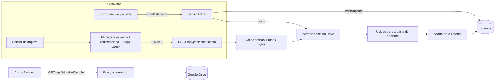

# TDD — Foto do Paciente no Google Drive e Componente Único de Avatar

| Campo | Valor |
|-------|-------|
| **Tech Lead** | @Raniery |
| **Product Owner** | @Dr. Felipe |
| **Time** | Engenharia (MedGuia Hub) · Coordenação de Recepção (validação) · Fisioterapeutas (uso clínico) |
| **Origem** | [PRD 006](../prds/006-foto-do-paciente-google-drive-e-avatar.md) · [RFC 006](../rfcs/006-foto-do-paciente-google-drive-e-avatar.md) — **Opção 1 aprovada em 2026-09-02**, decisões A–F resolvidas |
| **Precedente** | [TDD 004](004-venda-em-consultorio-e-relatorio-historico-de-vendas.md) — mesmo padrão de migração aditiva + rota como ponto único de regra |
| **Status** | Draft — pronto para aprovação |
| **Porte** | Médio-grande (~8–10 dias-pessoa, estimativa revisada pela Decisão F) |
| **Tipo** | Feature + integração externa (Google Drive) + dado pessoal sensível (LGPD) |
| **Criado** | 2026-09-02 |
| **Última atualização** | 2026-09-02 |

> **Correção de levantamento em relação à RFC 006.** A RFC assume que a agenda renderiza `CartaoAgendamento`. Ela **não** renderiza: as views dia e semana usam `AgendamentoItemDia` / `AgendamentoItemSemana` ([`agenda/page.tsx:780`](../../src/app/(painel)/agenda/page.tsx#L780) e [L838](../../src/app/(painel)/agenda/page.tsx#L838)), ambos definidos em [`AgendamentoItem.tsx`](../../src/components/features/agenda/AgendamentoItem.tsx). `CartaoAgendamento` é usado no **prontuário do paciente**. A Decisão F não muda de mérito, mas muda de arquivo-alvo e ganha um requisito extra de dados — ver [§5.6](#56-agenda--decisão-f).

---

## Contexto

### Background

O MedGuia Hub identifica paciente por iniciais em oito pontos de renderização, cada um com sua própria lógica duplicada. Nenhum paciente tem foto — a coluna não existe. A tabela `pacientes` tem 24 colunas, **nenhuma de foto** e **nenhum `updated_at`**.

A integração com o Google Drive está ativa e é o repositório oficial de mídia da clínica: OAuth2 com escopo `drive`, tokens em `configuracoes_sistema`, renovação automática em [`getClienteAutenticado()`](../../src/lib/google-drive.ts#L78), pastas por paciente sob `MedGuia - Pacientes / [Nome] [ID8]`, e um proxy autenticado [`/api/drive/file/[fileId]`](../../src/app/api/drive/file/%5BfileId%5D/route.ts) que já entrega `Cache-Control: private, max-age=3600` e suporta `Range`.

A RFC 006 decidiu a **Opção 1**: a foto deixa de ser campo do `<form>` e passa a ser um recurso com ciclo de vida próprio — comprimida no cliente, enviada por rota dedicada, persistida por um ponto único de servidor. Este TDD documenta **como** essa decisão vira código: o contrato da rota, o esquema da migração, as mudanças nas Server Actions, os estados do componente e o plano de aplicação.

### Domínio

Cadastro e identificação de paciente. O dado manipulado é **fotografia de pessoa identificada em contexto de saúde** — dado pessoal sob a LGPD, tratado neste projeto com o mesmo rigor de dado sensível. É o primeiro dado desse tipo a trafegar pelo proxy do Drive, o que torna a seção de [Segurança](#considerações-de-segurança-e-lgpd) obrigatória e não decorativa.

### Stakeholders

| Quem | Interesse |
|------|-----------|
| Recepção | Conferência de identidade na chegada; o upload entra no fluxo de cadastro diário — precisa ser um passo, não um formulário |
| Fisioterapeutas | Reconhecer o paciente antes de recebê-lo; é a origem do argumento clínico da Decisão F |
| Gestão / Dr. Felipe | Mídia do paciente centralizada na pasta dele no Drive; conformidade LGPD |
| Engenharia | Eliminar oito duplicações de avatar e corrigir o `void criarPastaPaciente` que produz pacientes sem pasta |

---

## Definição do Problema e Motivação

### Problemas que estamos resolvendo

**1. Identificação de paciente é verbal**
Com 9.632 pacientes ativos, homônimos e nomes parecidos são rotina. A conferência hoje é perguntar o nome.
*Impacto:* risco assistencial — atendimento, evolução ou venda lançados no prontuário errado. Não há métrica do incidente porque não há como detectá-lo hoje.

**2. O avatar é duplicado em oito lugares**
Oito pontos de renderização, três geometrias, duas paletas. A foto entraria como a nona duplicação se não houver componente.
*Impacto:* qualquer ajuste visual custa oito edições, e o fallback de imagem quebrada teria que ser reimplementado oito vezes.

**3. 572 pacientes (5,6%) não têm pasta no Drive**
[`pacientes.ts:173`](../../src/actions/pacientes.ts#L173) chama `void criarPastaPaciente(...)` sem `await` e a linha seguinte redireciona. A promise morre junto com a request.
*Impacto:* defeito **latente hoje** — ninguém percebe porque nada depende da pasta. A foto é exatamente o que o torna visível: o upload falharia com 404 para 1 em cada 18 pacientes.

**4. O fluxo literal do PRD não cabe no runtime**
Server Action tem corpo de **1 MB** por padrão e o [`next.config.ts`](../../next.config.ts) não sobrescreve. Foto de celular tem 3–8 MB.
*Impacto:* rejeição pelo runtime antes de qualquer código nosso — e o `redirect()` no fim das actions impede devolver o toast de warning que o PRD exige.

### Por que agora

Captação retroativa está fora do escopo do PRD: cada semana sem o campo é uma semana de cadastros que nascem sem foto. E a decisão de transporte define o formato do componente e das actions — errar aqui significa mexer duas vezes nas duas telas que a recepção usa todo dia.

### Impacto de não fazer

A conferência de identidade segue verbal; a duplicação do avatar cresce a cada tela nova; e os 572 pacientes sem pasta continuam se acumulando silenciosamente.

---

## Escopo

### ✅ Dentro do escopo (V1)

- Migração aditiva em `pacientes`: `foto_drive_file_id` e `foto_atualizada_em` (**sem** `foto_drive_url` — Decisão A).
- Módulo cliente de validação e redimensionamento de imagem (lado maior **1024 px**, WebP com fallback JPEG).
- Rota dedicada `POST` / `DELETE /api/pacientes/[id]/foto`, com validação por **magic bytes**, garantia de pasta e remoção do arquivo anterior.
- `criarPaciente` passa a **aguardar** a criação da pasta e a **retornar o id** em vez de redirecionar do servidor.
- Componente único `AvatarPaciente`, com fallback de iniciais, badge de status e prop `ampliavel`.
- Lightbox extraído de `TabMidiasPaciente` para componente reusável.
- Migração dos **8 pontos de renderização** existentes.
- Upload/troca/remoção de foto em `/pacientes/novo` e `/pacientes/[id]/editar`.
- Avatar na agenda, views **dia e semana** (Decisão F), com baseline e remedição de performance.

### ❌ Fora do escopo (V1)

- Crop manual, rotação e zoom no navegador (ajuste por `object-fit: cover`).
- Captura direta por webcam (o seletor nativo já abre a câmera em tablet/celular).
- Reconhecimento facial e importação retroativa de fotos de redes sociais.
- Registro da foto em `paciente_midias` (Decisão B).
- Coluna `foto_drive_url` / `webViewLink` (Decisão A).
- Avatar na view **mês** da agenda (Decisão F, mitigação 2).
- Endurecer a autorização do proxy `/api/drive/file/[fileId]` (Decisão C — item separado).
- Backfill dos 572 pacientes sem pasta como rotina em lote (são absorvidos sob demanda, no primeiro upload).

### 🔮 Considerações futuras (V2+)

- Autorização por recurso no proxy do Drive (Decisão C).
- Avatar na view mês, se a medição da Decisão F mostrar folga.
- Segregação de acesso por carteira de pacientes (invalida a Premissa 3 da RFC).

---

## Solução Técnica

### 5.1 Visão de arquitetura

O princípio é: **o formulário nunca carrega bytes de imagem**. Texto do paciente e foto viajam por caminhos independentes, e a falha de um não derruba o outro.



**Componentes e responsabilidades:**

| Componente | Responsabilidade | Estado |
|---|---|---|
| Módulo cliente de imagem | Validar extensão/MIME/tamanho, redimensionar para 1024 px, exportar WebP (fallback JPEG) | Novo |
| `POST/DELETE /api/pacientes/[id]/foto` | Ponto **único** de escrita da foto: sessão, magic bytes, pasta, upload, limpeza do anterior, persistência | Novo |
| `garantirPastaPacientePorId` | Cria a pasta se não existir; absorve os 572 legados | [Existe](../../src/actions/google-drive.ts#L180) — reusado |
| `/api/drive/file/[fileId]` | Leitura autenticada da imagem, com cache privado de 1 h | [Existe](../../src/app/api/drive/file/%5BfileId%5D/route.ts) — sem alteração |
| `AvatarPaciente` | Renderização única do avatar: foto, fallback, status, ampliação | Novo |
| Lightbox de mídia | Ampliação ao clique | [Existe em `TabMidiasPaciente.tsx:265`](../../src/components/features/pacientes/TabMidiasPaciente.tsx#L265) — extraído |
| `criarPaciente` / `editarPaciente` | Só texto; `criarPaciente` passa a aguardar a pasta e devolver o id | [Existe](../../src/actions/pacientes.ts#L104) — alterado |

### 5.2 Modelo de dados

**Migração aditiva** em `database/pacientes_foto_drive_migration.sql`, no padrão `ADD COLUMN IF NOT EXISTS` já usado no projeto:

| Coluna | Tipo | Nulo | Semântica |
|---|---|---|---|
| `foto_drive_file_id` | `TEXT` | sim (default `NULL`) | Id do arquivo no Google Drive. `NULL` = sem foto |
| `foto_atualizada_em` | `TIMESTAMPTZ` | sim (default `NULL`) | Momento da última troca. **Único cache-buster disponível** — a tabela não tem `updated_at` |

- Índice **parcial** sobre `foto_drive_file_id` filtrado por `IS NOT NULL`: a coluna começa 100% nula e cresce devagar; índice cheio seria desperdício.
- Sem `NOT NULL`, sem default não-nulo, sem constraint nova: a migração é aditiva pura e **não bloqueia** as 10.206 linhas existentes.
- `foto_drive_url` **não** é criada (Decisão A): o PRD proíbe link público e a leitura é 100% via proxy — a coluna nasceria morta.

**Leitura.** A listagem usa `select` de colunas explícitas ([`page.tsx:30`](../../src/app/(painel)/pacientes/page.tsx#L30)) e precisa ganhar as duas colunas novas. O prontuário usa `select('*')` e as recebe de graça. A query leve da agenda traz hoje apenas `pacientes (nome)` — ver [§5.6](#56-agenda--decisão-f).

### 5.3 Contrato da rota de foto

Route Handler — **sem** o limite de 1 MB da Server Action, e sem alterar nenhuma configuração global.

#### `POST /api/pacientes/{id}/foto`

**Request:** `multipart/form-data` com um campo `file`.

| Regra | Valor | Onde é aplicada |
|---|---|---|
| Sessão autenticada | Supabase Auth | Servidor (401 se ausente) |
| MIME aceito | `image/jpeg`, `image/png`, `image/webp` | Cliente **e** servidor |
| Verificação de tipo | **Magic bytes** do conteúdo, não `file.type` | Servidor — o cliente controla `file.type` |
| Tamanho máximo aceito na rota | 2 MB | Servidor (o cliente já entrega ~150 KB; a folga cobre variação de compressão) |
| Nome no Drive | `foto_perfil_[ID8].{ext}` | Servidor |
| Destino | Pasta do paciente (`paciente_pastas_drive`), criada sob demanda | Servidor |
| Permissão do arquivo | **Herdada da pasta.** Nenhuma permissão explícita é criada | Servidor |

**Resposta `200`:**

```json
{
  "fotoDriveFileId": "1AbC...",
  "fotoAtualizadaEm": "2026-09-02T14:31:00.000Z"
}
```

**Respostas de erro:**

| Status | Situação | Corpo |
|---|---|---|
| `400` | Sem arquivo, MIME recusado, magic bytes divergentes, acima de 2 MB | `{ "error": "<mensagem para o operador>" }` |
| `401` | Sem sessão | `{ "error": "Não autenticado" }` |
| `404` | Paciente inexistente | `{ "error": "Paciente não encontrado" }` |
| `502` | Drive desconectado, token expirado ou falha de upload | `{ "error": "Não foi possível salvar a foto no Drive" }` |

**Ordem de operações (importa para não gerar órfão):**

1. Valida sessão → tipo → tamanho.
2. Garante a pasta do paciente (`garantirPastaPacientePorId`).
3. Lê o `foto_drive_file_id` **atual** e guarda em memória.
4. Sobe o arquivo novo.
5. Persiste `foto_drive_file_id` e `foto_atualizada_em` no banco.
6. **Só então** apaga o arquivo antigo no Drive.

A limpeza é o último passo de propósito: se ela falhar, sobra um arquivo órfão — recuperável, e registrado em log. Se a ordem fosse invertida e o upload falhasse depois do delete, o paciente ficaria **sem foto nenhuma**. Trocamos um risco de lixo por um risco de perda de dado.

#### `DELETE /api/pacientes/{id}/foto`

Zera `foto_drive_file_id` e `foto_atualizada_em` no banco e move o arquivo para a lixeira do Drive. Resposta `200` com `{ "ok": true }`. Remoção de paciente sem foto é **idempotente** — responde `200`, não `404`.

### 5.4 Mudanças nas Server Actions

| Action | Mudança | Motivo |
|---|---|---|
| `criarPaciente` | `void criarPastaPaciente(...)` → **`await`** | O upload seguinte depende da pasta existir |
| `criarPaciente` | `redirect('/pacientes')` → retorno `{ pacienteId }` no `PacienteFormState` | Uma action que redireciona **não devolve estado** ao `useActionState`; sem isso o toast de warning do PRD é impossível |
| `editarPaciente` | Nenhuma alteração de fluxo | A foto age fora do submit; editar telefone não dispara nada no Drive |

**Contrato de estado do formulário de cadastro.** `PacienteFormState` ganha um campo opcional `pacienteId`. O cliente passa a orquestrar o pós-sucesso:

1. Action retorna `pacienteId` → o formulário detecta pelo `useActionState`.
2. Se há foto selecionada, chama a rota de foto.
3. Sucesso → `toast.success` e `router.push('/pacientes')`.
4. Falha da foto → `toast.warning` ("paciente cadastrado; a foto não pôde ser salva e pode ser enviada depois") e **navega assim mesmo**.

O passo 4 é o requisito de resiliência do PRD, e é o único ponto do desenho onde ele é implementável.

**Risco herdado.** `criarPaciente` tem dois caminhos de retorno prévios ao insert — CPF duplicado e candidatos a duplicado ([`pacientes.ts:141`](../../src/actions/pacientes.ts#L141) e [L154](../../src/actions/pacientes.ts#L154)) — que já devolvem estado sem redirecionar. Trocar o `redirect` final por retorno faz **todos** os caminhos passarem a devolver estado; o cliente precisa distinguir "sucesso com id" de "warning de duplicado" pela presença de `pacienteId`, não pela ausência de `error`. É a regressão mais provável desta entrega e tem teste dedicado.

### 5.5 Componente `AvatarPaciente`

Props (assinatura do PRD + `ampliavel` da Decisão E):

```typescript
interface AvatarPacienteProps {
  nome: string
  fotoDriveFileId?: string | null
  fotoAtualizadaEm?: string | null
  size?: 'xs' | 'sm' | 'md' | 'lg' | 'xl' | '2xl'
  isAtivo?: boolean
  mostrarStatus?: boolean
  ampliavel?: boolean
  className?: string
  priority?: boolean
}
```

**Máquina de estados de renderização:**

| Estado | Condição | O que aparece |
|---|---|---|
| `fallback` | `fotoDriveFileId` nulo/vazio | Duas iniciais em caixa alta sobre `#006b5a` |
| `carregando` | Foto presente, imagem ainda não resolvida | Skeleton suave — **nunca** o ícone de imagem quebrada do navegador |
| `foto` | `onLoad` disparou | `` com `object-fit: cover` |
| `fallback` (degradado) | `onError` disparou | Volta às iniciais, sem alterar o layout |

**Regras fixas:**

- URL da imagem: `/api/drive/file/{fotoDriveFileId}?v={fotoAtualizadaEm}` — o `?v=` invalida o cache privado de 1 h do proxy quando a foto muda.
- `priority` só no prontuário digital. Em toda lista, `loading="lazy"`.
- `ampliavel` só tem efeito **com foto**: ampliar iniciais não faz sentido, e o avatar não vira clicável nesse caso.
- Geometria por `size`, cobrindo os tamanhos já existentes: `sm` = `w-9 h-9`, `md` = `w-10 h-10`, `2xl` = `w-28 h-28 rounded-3xl`.
- Badge de status: `#25D366` ativo, vermelho inativo — só quando `mostrarStatus`.

**Pontos de renderização a migrar (8, mais a agenda):**

| # | Tela | Arquivo | `size` | `ampliavel` |
|---|---|---|---|---|
| 1 | Prontuário digital | [`pacientes/[id]/page.tsx:374`](../../src/app/(painel)/pacientes/%5Bid%5D/page.tsx#L374) | `2xl` | ✅ |
| 2 | Listagem — tabela | [`pacientes/page.tsx:106`](../../src/app/(painel)/pacientes/page.tsx#L106) | `sm` | ❌ |
| 3 | Listagem — cards | [`pacientes/page.tsx:175`](../../src/app/(painel)/pacientes/page.tsx#L175) | `md` | ❌ |
| 4 | Card de confirmação | [`CardConfirmacaoPaciente.tsx:139`](../../src/components/features/pacientes/CardConfirmacaoPaciente.tsx#L139) | `md` | ✅ |
| 5 | Confirmações da semana | [`confirmacoes/semana/page.tsx:254`](../../src/app/(painel)/confirmacoes/semana/page.tsx#L254) | `sm` | ❌ |
| 6 | Follow-ups | [`follow-ups/page.tsx:424`](../../src/app/(painel)/follow-ups/page.tsx#L424) | `sm` | ❌ |
| 7 | Prontuários — listagem | [`prontuarios/page.tsx:421`](../../src/app/(painel)/prontuarios/page.tsx#L421) e [L498](../../src/app/(painel)/prontuarios/page.tsx#L498) | `sm` | ❌ |
| 8 | Prontuário de atendimento | [`prontuarios/[atendimentoId]/page.tsx:93`](../../src/app/(painel)/prontuarios/%5BatendimentoId%5D/page.tsx#L93) | `lg` | ✅ |
| 9 | Agenda (dia/semana) | [`AgendamentoItem.tsx`](../../src/components/features/agenda/AgendamentoItem.tsx) | `xs`/`sm` | ❌ |

Cada tela migrada precisa que sua query traga `foto_drive_file_id` e `foto_atualizada_em` — **é o passo mais fácil de esquecer**, e o sintoma é silencioso: o avatar simplesmente cai no fallback de iniciais e ninguém percebe que a foto existe.

### 5.6 Agenda — Decisão F

A RFC aponta `CartaoAgendamento`; o alvo real é `AgendamentoItemDia` / `AgendamentoItemSemana`. Além do componente, há um requisito de dados que a RFC não previu: a **query leve** da agenda seleciona `pacientes (nome)` ([`agenda/page.tsx:288`](../../src/app/(painel)/agenda/page.tsx#L288)) e precisa passar a selecionar `pacientes (nome, foto_drive_file_id, foto_atualizada_em)` nas quatro variantes da query (com e sem filtro de profissional, dia e semana).

Mitigações obrigatórias registradas na RFC, todas verificáveis em revisão:

1. `loading="lazy"` em **todo** avatar de agenda — nenhum `priority`.
2. Avatar **só nas views dia e semana**. A view mês não recebe avatar e sua query permanece intocada.
3. **Baseline antes, remedição depois** — ver [Monitoramento](#monitoramento-e-observabilidade).
4. `ampliavel` **desligado**: o clique no cartão já abre o agendamento.

O item 3 é a válvula de escape: se a view semana regredir de forma perceptível, o avatar da agenda sai e volta como fase 2, **sem bloquear os outros 8 pontos**.

---

## Considerações de Segurança e LGPD

### Classificação do dado

Fotografia de pessoa identificada em contexto de saúde. Tratada aqui com o rigor de dado sensível: sem link público, sem cache compartilhado, sem exposição fora de sessão autenticada.

### Controle de acesso

| Camada | Mecanismo | Estado |
|---|---|---|
| Escrita da foto | Rota exige sessão Supabase Auth; 401 sem sessão | Novo |
| Leitura da foto | Proxy `/api/drive/file/[fileId]` exige sessão; 401 sem sessão | [Já existe](../../src/app/api/drive/file/%5BfileId%5D/route.ts#L11) |
| Arquivo no Drive | **Nenhuma** permissão explícita é criada. Herda a pasta do paciente | Novo |
| Autorização por recurso | **Ausente** — ver limitação aceita abaixo | Decisão C |

**Limitação conhecida e aceita (Decisão C).** O proxy valida apenas *"está logado"*. Qualquer usuário autenticado do Hub que conheça um `fileId` baixa qualquer arquivo do Drive da clínica. A foto **não cria** essa brecha, mas é o primeiro dado biométrico a trafegar por ela. Fica registrada como item separado, sem bloquear esta entrega — consistente com a Premissa 3 da RFC (hoje não há segregação de pacientes por profissional). **Se a Premissa 3 cair, este item vira bloqueante.**

### Validação de entrada

- **Dupla validação de tipo.** O cliente filtra por extensão e MIME (UX); o servidor decide pelos **magic bytes** do conteúdo. `file.type` é controlado pelo cliente e não é evidência de nada.
- Recusa explícita de qualquer coisa que não seja `image/jpeg`, `image/png` ou `image/webp` — atende o "NUNCA PODE" de executáveis do PRD.
- Teto de 2 MB na rota, independente do que o cliente afirme.
- O `id` do paciente vem do path e é validado contra a tabela antes de qualquer chamada ao Drive.

### Proteção do dado

- **Em trânsito:** HTTPS ponta a ponta; o proxy nunca expõe o access token ao navegador.
- **Em repouso:** o arquivo vive só no Google Drive da clínica; o banco guarda apenas o identificador. **Nunca base64 no Postgres** — proibição explícita do PRD.
- **Cache:** `private, max-age=3600`. `private` é o que impede cache compartilhado em proxy intermediário.
- **Retenção e exclusão:** `DELETE` na rota remove do Drive e zera as colunas — é o mecanismo de atendimento a pedido de exclusão de imagem pelo titular.

### O que nunca é logado

Bytes de imagem, access token do Drive, e nome de paciente junto do `fileId` na mesma linha de log. Os logs de erro carregam `pacienteId` e `fileId`, que só são resolvíveis por quem já tem acesso ao banco.

---

## Riscos

| # | Risco | Impacto | Probabilidade | Mitigação |
|---|---|---|---|---|
| 1 | Regressão no fluxo de duplicados/CPF ao trocar `redirect()` por retorno de id em `criarPaciente` | **Alto** — trava o cadastro diário da recepção | **Média** | Teste de regressão dedicado nos 4 caminhos de retorno (CPF duplicado, candidato a duplicado, sucesso, erro de insert) antes de qualquer trabalho de UI |
| 2 | Regressão de performance na agenda (Decisão F) | Alto — tela mais densa, com histórico de regressão nas RFCs 002/003 | **Média** | Baseline antes, remedição depois; `lazy` obrigatório; mês fora; reversão isolada sem afetar os outros 8 pontos |
| 3 | Arquivo órfão no Drive quando a limpeza do anterior falha | Baixo — lixo, não perda | Média | Ordem de operações que prioriza não perder foto; log de falha de limpeza com `fileId` para varredura posterior |
| 4 | Token do Drive expirado/revogado no momento do upload | Médio — foto não salva | Média | `502` tratado como warning no cliente; cadastro/edição concluem; foto reenviável a qualquer momento |
| 5 | Tela migrada sem incluir as colunas novas no `select` | Baixo, mas **silencioso** | **Alta** | Checklist por tela no plano de implementação; verificação visual explícita de cada um dos 9 pontos |
| 6 | Navegador sem `canvas.toBlob` em WebP | Baixo | Baixa | Fallback JPEG no mesmo módulo (Premissa 5 da RFC) |
| 7 | Upload de imagem com conteúdo malicioso disfarçado | Médio | Baixa | Magic bytes no servidor; o arquivo é servido com `content-disposition: inline` e MIME do Drive, nunca executado |
| 8 | Cota do Drive | Baixo | Baixa | ~10 mil arquivos × ~150 KB ≈ 1,5 GB no Drive existente (Premissa 4) |

---

## Estratégia de Testes

| Tipo | Escopo | Como |
|---|---|---|
| **Unitário** | Módulo de imagem: validação de tipo, teto de tamanho, cálculo de dimensão | Vitest, no padrão dos testes já existentes em `src/lib/*.test.ts` |
| **Unitário** | `AvatarPaciente`: os quatro estados de renderização e a montagem da URL com `?v=` | Vitest + Testing Library |
| **Integração** | Contrato da rota de foto: cada status de resposta | Chamada real à rota com sessão de teste |
| **Regressão manual** | Fluxo de duplicados/CPF em `/pacientes/novo` e `/pacientes/[id]/editar` | Roteiro abaixo — **bloqueante** |
| **Resiliência** | Drive desconectado | Roteiro abaixo — **bloqueante para o deploy** |
| **Performance** | Agenda dia/semana/mês com dia cheio | Baseline + remedição (Decisão F) |

### Cenários obrigatórios

**Rota de foto:**
- Sem sessão → `401`.
- PDF renomeado para `.jpg` → `400` (pega pelos magic bytes, não pela extensão).
- Arquivo acima de 2 MB → `400`.
- Paciente **sem pasta no Drive** (um dos 572) → pasta criada, upload conclui `200`.
- Troca de foto → `fileId` antigo não existe mais no Drive.
- `DELETE` em paciente sem foto → `200`, idempotente.
- Drive desconectado → `502`, e **nenhuma** coluna alterada no banco.

**Regressão de cadastro (risco 1) — os quatro caminhos:**
- CPF já cadastrado → mensagem de erro, sem navegação, sem upload.
- Nome homônimo → tela de confirmação de duplicado, sem navegação, sem upload.
- Confirmação de duplicado → paciente criado, foto enviada, navegação.
- Erro de insert no banco → erro exibido, sem upload.

**Resiliência (bloqueante):**
- Com o Drive desconectado, cadastrar paciente **com** foto selecionada → paciente criado, `toast.warning`, navegação normal.
- Com o Drive desconectado, editar telefone de paciente **com** foto → edição conclui, foto preservada, nenhuma chamada ao Drive.

**Componente:**
- Paciente sem foto → iniciais.
- `fileId` apontando para arquivo apagado no Drive → `onError` → iniciais, **sem** ícone de imagem quebrada e sem mudança de layout.
- Foto trocada → o novo `?v=` derruba o cache e a imagem nova aparece.

### Dados de teste

Pacientes reais de produção **não** são usados para teste de upload. O ambiente de validação usa pacientes de teste criados para esse fim, e as fotos são apagadas pela própria rota `DELETE` ao final.

---

## Monitoramento e Observabilidade

Não há APM neste projeto. A observabilidade é por log estruturado na VPS e por verificação direta no banco — o mesmo padrão dos TDDs anteriores.

### Eventos de log

| Evento | Nível | Campos |
|---|---|---|
| Foto salva | info | `pacienteId`, `fileId`, `bytes`, `duracaoMs` |
| Foto removida | info | `pacienteId`, `fileId` |
| Falha de upload no Drive | error | `pacienteId`, causa, status do Drive |
| **Falha ao apagar o arquivo anterior** | warn | `pacienteId`, `fileIdOrfao` — é a fonte da varredura de órfãos |
| Rejeição por magic bytes | warn | `pacienteId`, MIME declarado vs. detectado |
| Pasta criada sob demanda | info | `pacienteId` — mede a drenagem dos 572 |

### O que acompanhar depois da liberação

| Indicador | Como | Alvo |
|---|---|---|
| Adoção | `COUNT(*) WHERE foto_drive_file_id IS NOT NULL` sobre cadastros dos últimos 30 dias | > 70% (meta do PRD) |
| Pacientes sem pasta | `pacientes` × `paciente_pastas_drive` | Cair de 572, nunca subir |
| Órfãos no Drive | Ocorrências do log `warn` de falha de limpeza | Zero; varredura manual se aparecer |
| Falhas de upload | Ocorrências do log `error` | Investigar qualquer sequência — indica token do Drive |

### Baseline de performance da agenda (Decisão F)

Medir **antes** de tocar na agenda e repetir depois, com o mesmo dia cheio e as mesmas condições:

| Medida | Views |
|---|---|
| Tempo de render do servidor | dia, semana, mês |
| Nº de requisições ao proxy na carga inicial | dia, semana |
| Tempo até a tela ficar utilizável | dia, semana |

**Critério de reversão:** regressão perceptível na view semana ⇒ o avatar da agenda sai e volta como fase 2. A decisão é do Tech Lead com base na comparação, e não bloqueia o resto da entrega.

---

## Plano de Rollback

A entrega é reversível em camadas independentes, da mais barata para a mais cara.

| Nível | Gatilho | Ação | Perda |
|---|---|---|---|
| **1 — Agenda** | Regressão de performance na agenda | Reverter só o avatar em `AgendamentoItem` e o `select` da query leve | Nenhuma. Os outros 8 pontos seguem |
| **2 — Exibição** | Avatar quebrando alguma tela | Remover as colunas dos `select` — o componente cai no fallback de iniciais em todo lugar | Nenhuma. As fotos continuam no Drive e no banco |
| **3 — Escrita** | Falha sistemática de upload | Desabilitar o seletor de foto nos dois formulários | Cadastro segue funcionando; fotos existentes continuam aparecendo |
| **4 — Actions** | Regressão no fluxo de cadastro (risco 1) | Reverter `criarPaciente` para o comportamento anterior | Volta o `void` da pasta e o `redirect`; obriga reverter também o nível 3 |
| **5 — Schema** | Só em caso extremo | `DROP COLUMN` das duas colunas | Perde a associação paciente↔foto. Os arquivos permanecem no Drive |

**Ordem correta:** 1 → 2 → 3 → 4. O nível 5 quase certamente **não deve ser executado** — as colunas nulas não custam nada e preservam o vínculo caso a decisão seja revista.

**Migração para trás.** A migração é aditiva e não altera dado existente; não há necessidade de down migration para operar o rollback funcional.

**Comunicação.** Reversão dos níveis 3 ou 4 exige avisar a recepção antes do próximo expediente — o passo do cadastro muda para eles.

---

## Plano de Implementação

Ordem escolhida para que cada fase seja verificável isoladamente e para que o risco mais alto (a mudança nas actions) seja resolvido **antes** de qualquer trabalho de UI depender dele.

| Fase | Tarefa | Entregável verificável | Estimativa |
|---|---|---|---|
| **0 — Baseline** | Medir render da agenda (dia/semana/mês, dia cheio) | Números registrados neste TDD | 0,5 d |
| **1 — Banco** | Migração aditiva via SQL Editor do Studio | Colunas e índice parcial existindo em produção | 0,5 d |
| **2 — Actions** | `await` na pasta + retorno de id em `criarPaciente`; ajuste do cliente | **Teste de regressão dos 4 caminhos passando** | 1,5 d |
| **3 — Imagem** | Módulo cliente de validação e resize 1024 px WebP | Testes unitários; arquivo de 6 MB saindo a ~150 KB | 1 d |
| **4 — Rota** | `POST`/`DELETE /api/pacientes/[id]/foto` | Todos os cenários de contrato respondendo o status certo | 1,5 d |
| **5 — Componente** | `AvatarPaciente` + extração do lightbox | Os 4 estados de renderização; ampliação funcionando | 1,5 d |
| **6 — Formulários** | Upload/troca/remoção em `/novo` e `/editar` | **Teste de resiliência com Drive desconectado** | 1 d |
| **7 — Migração das telas** | Os 8 pontos + colunas nos respectivos `select` | Checklist visual, tela por tela | 1,5 d |
| **8 — Agenda** | Avatar em dia/semana + `select` das 4 variantes da query | Remedição comparada à fase 0 | 1 d |
| **9 — Liberação** | Comunicar a recepção; acompanhar adoção | Aviso enviado; primeira medição agendada para +30 d | 0,5 d |

**Total:** ~10 dias-pessoa.

**Dependências de ordem:**
- Fase 2 **antes** da 6 — o formulário depende do novo contrato de estado.
- Fase 1 **antes** da 4 — a rota escreve nas colunas novas.
- Fase 3 **antes** da 4 — o teto de 2 MB da rota pressupõe compressão no cliente.
- Fase 0 **antes** da 8, obrigatoriamente. Baseline medido depois não é baseline.
- Fase 7 **antes** da 8: a agenda é a mais arriscada e entra por último, para poder sair sozinha.

**Ponto de decisão.** Ao fim da fase 8, comparar com o baseline e decidir manter ou reverter o avatar da agenda. Registrar a decisão neste TDD, não só no PR.

---

## Métricas de Sucesso

| Métrica | Baseline | Alvo | Medição |
|---|---|---|---|
| Adoção em novos cadastros | 0% | > 70% em 30 dias | Consulta ao banco |
| Exposição pública de imagem | — | **Zero** | Nenhum arquivo com permissão explícita; auditoria no Drive |
| Tempo percebido do upload | — | < 2 s em banda larga | Log `duracaoMs` da rota |
| Página fria da listagem (50 avatares) | ~0 (sem foto) | ~7,5 MB | Aba de rede do navegador |
| Falha de fallback | — | **Zero** tela quebrada | Teste do componente + verificação nos 9 pontos |
| Pacientes sem pasta no Drive | 572 | Trajetória decrescente | Consulta ao banco |
| Regressão de render na agenda | Fase 0 | Sem regressão perceptível na semana | Remedição |

---

## Dependências

| Dependência | Tipo | Estado | Risco |
|---|---|---|---|
| Google Drive API (OAuth2 escopo `drive`) | Externa | Em produção | Médio — token já expirou antes; tratado como `502` |
| `garantirPastaPacientePorId` | Interna | [Existe](../../src/actions/google-drive.ts#L180) | Baixo |
| Proxy `/api/drive/file/[fileId]` | Interna | Em produção | Baixo |
| Lightbox de `TabMidiasPaciente` | Interna | Existe; será extraído | Baixo — a extração pode regredir a aba de mídias, que entra na verificação |
| Acesso ao SQL Editor do Studio | Infra | Disponível | Baixo — DDL não passa por REST |
| Supabase Auth | Interna | Em produção | Baixo |

**Aprovações necessárias:** @Dr. Felipe já aprovou a RFC 006 com as decisões A–F. Este TDD precisa de aprovação técnica antes da fase 1.

---

## Questões em Aberto

| # | Questão | Contexto | Dono | Status |
|---|---|---|---|---|
| 1 | Arquivo órfão detectado no log tem rotina de limpeza ou tratamento manual? | Espera-se volume próximo de zero; rotina pode ser overkill | @Raniery | 🟡 Decidir se aparecer o primeiro |
| 2 | Foto de paciente inativo deve continuar aparecendo? | Hoje o inativo aparece na listagem com badge vermelho; nada muda por padrão | @Dr. Felipe | 🔴 Aberta — o padrão é manter |
| 3 | Excluir a foto ao inativar por óbito? | Ponto de retenção LGPD; não levantado no PRD | @Dr. Felipe | 🔴 Aberta — fora da V1 até decisão |
| 4 | Qual a fonte da medição da agenda (fase 0)? | Precisa ser reprodutível para a comparação valer | @Raniery | 🟡 Definir antes da fase 0 |

Nenhuma delas bloqueia o início da implementação. A **4** bloqueia a fase 0 e, por consequência, a fase 8.

---

## Glossário

| Termo | Significado |
|---|---|
| **Magic bytes** | Assinatura nos primeiros bytes do arquivo que identifica o formato real, independente da extensão ou do MIME declarado |
| **Cache-buster** | Parâmetro na URL (`?v=`) que força o navegador a rebuscar a imagem quando ela muda. Aqui é `foto_atualizada_em`, porque `pacientes` não tem `updated_at` |
| **Fire-and-forget** | Chamada assíncrona sem `await`. É o padrão hoje em `criarPastaPaciente` e a causa dos 572 pacientes sem pasta |
| **Proxy autenticado** | `/api/drive/file/[fileId]` — busca o arquivo no Drive com o token do servidor e o devolve ao navegador só se houver sessão |
| **Arquivo órfão** | Arquivo que permanece no Drive sem nenhuma linha do banco apontando para ele |
| **Ponto de renderização** | Cada lugar da aplicação que desenha um avatar de paciente. São 8 hoje, 9 com a agenda |
| **Migração aditiva** | `ADD COLUMN IF NOT EXISTS` sem `NOT NULL` nem default não-nulo — não reescreve a tabela e não bloqueia |

---

## Aprovação

| Papel | Nome | Status | Data |
|---|---|---|---|
| Tech Lead | @Raniery | ✅ Autor | 2026-09-02 |
| Product Owner | @Dr. Felipe | ⏳ Pendente | — |

**Critérios de aprovação:**

- [x] Alinhado à Opção 1 e às decisões A–F da RFC 006
- [x] Segurança e LGPD documentadas, com a limitação da Decisão C explicitada
- [x] Rollback em camadas independentes
- [x] Testes bloqueantes identificados (regressão de cadastro e resiliência com Drive desconectado)
- [ ] Questão 4 respondida antes da fase 0
