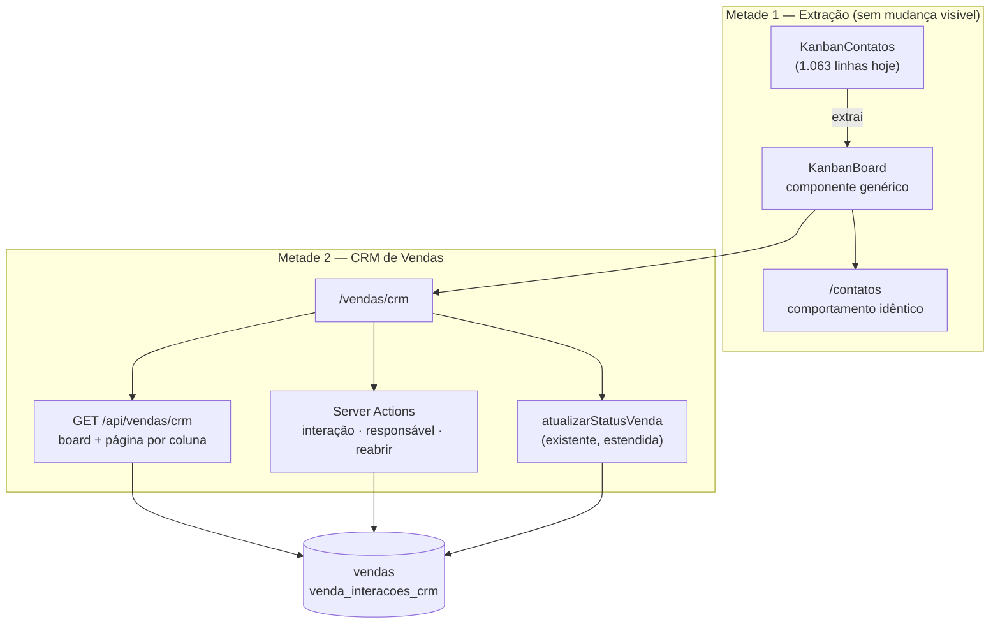

# TDD — CRM de Vendas: Pipeline Kanban, Régua de Follow-up e Responsável Comercial

| Campo | Valor |
|-------|-------|
| **Tech Lead** | @Raniery |
| **Product Owner** | @Dr. Felipe |
| **Time** | Engenharia (MedGuia Hub) · Recepção (operação da régua) · Gestão Comercial (KPIs) |
| **Origem** | [PRD 008](../prds/008-crm-de-vendas-e-orcamentos-kanban-e-follow-up.md) · [RFC 008](../rfcs/008-crm-de-vendas-e-orcamentos-kanban-e-follow-up.md) — **Opção 2 aprovada em 2026-09-18**, decisões A–F resolvidas |
| **Precedente** | [TDD 006](006-foto-do-paciente-google-drive-e-avatar.md) — mesmo padrão de rollback em camadas e migração aditiva · [TDD 004](004-venda-em-consultorio-e-relatorio-historico-de-vendas.md) — regra única no servidor |
| **Status** | Draft — pronto para aprovação |
| **Porte** | Grande (~20–24 dias-pessoa) |
| **Tipo** | Feature + refatoração de componente em produção + dado financeiro e pessoal (LGPD) |
| **Criado** | 2026-09-18 |
| **Última atualização** | 2026-09-18 — rev. 2: Q-1 a Q-4 respondidas; janela de correção de interação definida; nenhuma questão bloqueante em aberto |

> **Correção de levantamento em relação à RFC 008.** A RFC trata a Decisão D (*"fisioterapeuta não acessa o CRM na V1"*) como implementável por uma chave de módulo. **Não é.** [`resolverModulosEfetivos`](../../src/lib/modulos.ts#L194-L197) devolve `[]` para todo usuário com `nivel_acesso` `gestor` ou `master`, e [`requireModulo`](../../src/lib/guard.ts#L26) interpreta lista vazia como **acesso total** — o gate é ignorado. Medição de 18/09: **4 dos 10 fisioterapeutas têm `nivel_acesso = 'gestor'`**. `requireModulo('comercial:crm')` sozinho libera o CRM para eles. Ver [§5.9](#59-permissões-e-a-armadilha-do-nível-de-acesso), que é onde este TDD mais se afasta da RFC.

---

## Contexto

### Background

O MedGuia Hub registra vendas e orçamentos desde o início da operação comercial. A tabela `vendas` opera três status — `venda_confirmada`, `orcamento_pendente`, `orcamento_recusado` — e o fluxo de confirmação já é rigoroso: [`atualizarStatusVenda`](../../src/actions/vendas.ts#L830) valida a soma dos pagamentos contra o total com tolerância de R$ 0,01 e recusa confirmar venda sem comprovante anexado.

O que não existe é a camada de **gestão** dessas oportunidades. Os 79 orçamentos pendentes, somando **R$ 238.650**, vivem misturados ao histórico faturado na listagem `/vendas`, sem ordenação por urgência, sem responsável nominal pelo fechamento e sem nenhum registro do que foi conversado com o paciente.

A RFC 008 aprovou construir essa camada **reusando** o Kanban que já existe em `/contatos` — quadro completo com drag-and-drop nativo, update otimista com rollback, paginação por coluna e fallback mobile — em vez de escrever um segundo.

### Domínio

Comercial / faturamento clínico. Cruza com prontuário (o orçamento nasce de uma avaliação), com o Google Drive (comprovantes) e com o cadastro de equipe (`profiles`).

### Stakeholders

| Quem | Interesse |
|---|---|
| **Recepção** (1 pessoa cadastrada) | Opera a régua no dia a dia. É quem ganha ou perde tempo com o desenho da tela |
| **Gestão / diretoria** | Quer saber quanto está represado, com quem, e qual a conversão real |
| **Fisioterapeutas** | Criam orçamentos na avaliação. **Não operam o quadro na V1** (Decisão D) |
| **Engenharia** | Herda a manutenção do componente extraído — e de `/contatos`, que passa a depender dele |

---

## Definição do Problema e Motivação

### Problemas que estamos resolvendo

**1. O funil não registra perda — e por isso nenhuma métrica comercial é confiável.**
São **217 vendas confirmadas contra 3 orçamentos recusados**. A fórmula de conversão do PRD devolveria 98,6%, número que ninguém na clínica acredita. Orçamento que morre não é marcado como recusado: fica pendente para sempre. Impacto: a clínica não sabe sua taxa de conversão real nem por que perde.

**2. R$ 238.650 parados sem dono e sem cadência.**
79 cards pendentes, mediana de **37 dias** desde a criação, **40 deles (51%) acima de 30 dias**. Não há SLA, não há alerta, não há fila de trabalho. Impacto: perda silenciosa de faturamento, proporcional ao tempo.

**3. O que o paciente respondeu não entra no sistema.**
Sem registro de interação, a informação vive no WhatsApp pessoal de quem ligou. Impacto: na troca de turno, a negociação recomeça do zero — e o paciente percebe.

**4. Não há accountability de fechamento.**
`vendas.profissional_id` é o profissional **clínico**. Quem negocia é a recepção. Não existe campo que registre isso. Impacto: não dá para cobrar nem reconhecer.

### Por que agora

Follow-up não é retroativo: cada semana sem a régua é uma safra de orçamentos que nunca terá histórico de contato. E a janela de reuso do Kanban de `/contatos` está aberta agora — se o CRM nascer como cópia, a extração vira refatoração de duas telas em produção.

### Impacto de não fazer

Os R$ 238.650 continuam envelhecendo sem dono, `motivo_recusa` segue acumulando texto livre não agregável, e a próxima tela de quadro do projeto nasce como terceira cópia da mesma mecânica.

---

## Escopo

### ✅ Dentro do escopo (V1)

- Extração do núcleo do Kanban de `/contatos` para componente compartilhado, com `/contatos` migrado **sem mudança de comportamento**.
- Rota `/vendas/crm` com as 3 colunas canônicas (Pendente / Fechado / Perdido), fixas em código (Decisão A).
- `responsavel_comercial_id` em `vendas`, independente de `profissional_id`, com reatribuição individual por card.
- Registro de interação comercial (canal, desfecho, anotação, próxima ação) em tabela dedicada.
- SLA de follow-up **calculado**, nunca persistido (dias corridos — Decisão C).
- Objeção de perda em campo próprio, obrigatória para mover o card para Perdido (Decisão B), validada no servidor.
- Reabertura de oportunidade (Perdido → Pendente) com registro.
- Filtro e badge "Estagnados >30 dias", **sem nenhuma escrita automática** (Decisão E).
- Painel de KPIs: cards e valor em aberto, follow-ups atrasados, ganhos no período, ticket médio.
- Link de WhatsApp com template contextualizado, por um helper unificado.

### ❌ Fora do escopo (V1)

- **Acesso do fisioterapeuta ao quadro** (Decisão D) — com ele saem a persona "Fisioterapeuta / Avaliador" do PRD e o requisito §5.2 de acompanhamento próprio.
- **Reatribuição em lote** (Decisão F) — 1 recepcionista cadastrada, não há carteira a redistribuir.
- **KPI de Taxa de Conversão exibido como número confiável** — ver [§5.10](#510-o-kpi-de-conversão-na-v1).
- Personalização de templates de WhatsApp por usuário.
- Aba de histórico comercial em `/pacientes/[id]`.
- Badge de follow-ups no sino de notificações.
- Exportação do funil (PDF/XLSX).
- Backfill de `responsavel_comercial_id` em vendas históricas.
- Colunas customizáveis por usuário.

### 🔮 Considerações futuras (V2+)

- `comercial:crm_completo` devolvendo o quadro ao fisioterapeuta, se a clínica quiser.
- Atalhos de interação em 1 toque (`Não atendeu`, `Mensagem enviada`).
- Campanha de reativação programada sobre a coluna Perdido.

---

## Solução Técnica

### 5.1 Visão de arquitetura

A entrega tem duas metades independentes. A primeira não produz tela nenhuma e é pré-requisito da segunda.

**Princípio que organiza tudo:** o quadro **nunca escreve status diretamente**. Arrastar para Fechado ou Perdido abre o modal correspondente, e a escrita passa por `atualizarStatusVenda` — a mesma função que a tela de detalhe usa hoje, com as mesmas travas financeiras. Cancelar o modal devolve o card à coluna de origem sem persistir nada.

### 5.2 Contrato do componente extraído

`KanbanBoard` recebe o que varia e não sabe nada sobre contatos nem sobre vendas.

| Prop | Responsabilidade |
|---|---|
| `colunas` | Lista ordenada: chave, rótulo, identidade visual, contagem e total do cabeçalho |
| `itens` | Cards já carregados, cada um com a chave da coluna a que pertence |
| `renderCard` | Render do conteúdo do card — **é aqui que contato e venda divergem** |
| `onMover(itemId, colunaDestino)` | Retorna `{ ok }` ou `{ erro }`. O board aplica o otimismo e reverte se vier erro |
| `podeMover(item, colunaDestino)` | Permite ao consumidor **interceptar** o move (é o gancho do modal obrigatório) |
| `carregarMais(colunaChave, offset)` | Paginação por coluna |
| `permiteArrastar` | Gate de desktop; no mobile o board usa os botões ◀ ▶ |

**O board mantém:** estado otimista, reversão com toast em caso de erro, contadores por coluna, paginação e navegação por botões. **O board não conhece:** status de venda, objeção, pagamento, SLA.

**Critério de sucesso da extração:** `/contatos` funciona exatamente como hoje. Qualquer mudança visível naquela rota é sinal de que o corte entre genérico e específico está errado — parar e reavaliar, não improvisar.

### 5.3 Modelo de dados

**Migração aditiva em `vendas`** (nenhuma coluna existente é alterada; nenhum dado é reescrito):

| Coluna | Tipo | Nota |
|---|---|---|
| `responsavel_comercial_id` | `uuid` FK → `profiles(id)` **`ON DELETE SET NULL`** | Preserva o histórico se o colaborador for excluído |
| `data_proximo_follow_up` | `date` | Única fonte de verdade do SLA |
| `data_ultimo_contato_crm` | `timestamptz` | Mantida pelo trigger de interação |
| `total_interacoes_crm` | `integer NOT NULL DEFAULT 0` | Contador desnormalizado |
| `data_reabertura_crm` | `timestamptz` | Marca Perdido → Pendente |
| `objecao_perda_motivo_id` | `uuid` FK → `objecoes_orcamento(id)` `ON DELETE SET NULL` | **Decisão B** — distinto de `objecao_motivo_id` |
| `objecao_perda_nome` | `text` | Nome congelado, padrão de `objecao_motivo_nome` |
| `objecao_perda_observacao` | `text` | Texto livre do desfecho |
| `data_reengajamento_sugerida` | `date` | Opcional, informada no modal de perda |

> **`status_follow_up` não existe.** O PRD (§6.1) propõe persistir esse valor com `CHECK`. É derivado de data: um card `vence_hoje` vira `atrasado` sozinho na virada do dia, sem `UPDATE` nenhum. Persistir exigiria um job de meia-noite — precedente caro no projeto ([RFC 002](../rfcs/002-ciclo-de-vida-dos-status-personalizados.md)). O valor é calculado a cada render. Ver [§5.5](#55-cálculo-do-sla).

**Nova tabela `venda_interacoes_crm`:**

| Campo | Tipo | Regra |
|---|---|---|
| `id` | `uuid` PK | |
| `venda_id` | `uuid` FK → `vendas(id)` `ON DELETE CASCADE` | Interação sem venda não faz sentido |
| `autor_id` | `uuid` FK → `profiles(id)` **`ON DELETE RESTRICT`** | "NUNCA PODE" do PRD: histórico não some com o colaborador |
| `canal` | `text` `CHECK` | `whatsapp · telefone · instagram · presencial · email · outro` |
| `desfecho` | `text` `CHECK` | `contato_sucesso · pediu_prazo · negociando_valores · nao_atendeu · sem_resposta · recusou_proposta · outro` |
| `descricao` | `text NOT NULL` | Anotação do que foi tratado |
| `data_contato` | `timestamptz` **`CHECK (data_contato <= now())`** | "NUNCA PODE" do PRD vira trava de banco, não de UI |
| `proxima_acao_data` | `date` (nulável) | **Pode ser futura** — é a única que pode |
| `proxima_acao_lembrete` | `text` (nulável) | Pauta do retorno |
| `criado_em` | `timestamptz` | |

Índices: `(venda_id, data_contato DESC)` para o histórico do card; em `vendas`, índice parcial em `data_proximo_follow_up` restrito a `status = 'orcamento_pendente'`, e `(status, responsavel_comercial_id)`.

**Trigger `AFTER INSERT`** em `venda_interacoes_crm` atualiza na venda: `total_interacoes_crm + 1`, `data_ultimo_contato_crm = NEW.data_contato`, e `data_proximo_follow_up = COALESCE(NEW.proxima_acao_data, data_proximo_follow_up)` — registrar sem agendar **não apaga** o agendamento anterior.

### 5.4 RLS — a parte que o PRD esqueceu

O SQL do PRD (§6.2) não declara RLS. Neste projeto, tabela nova nasce com RLS **ligado e sem policy**, e o sintoma é silencioso: a API devolve zero linhas, os dados existem, e só o service role enxerga. Está documentado em [`objecoes_orcamento_rls_fix.sql`](../../database/objecoes_orcamento_rls_fix.sql).

`venda_interacoes_crm` segue o padrão de [`venda_tags_migration.sql`](../../database/venda_tags_migration.sql#L20-L45):

| Policy | Quem | O quê |
|---|---|---|
| Leitura | `authenticated` | `SELECT` liberado — o controle de quem chega à tela é de aplicação |
| Escrita | `authenticated` com `autor_id = auth.uid()` | `INSERT` apenas em nome próprio |
| Correção pelo autor | `authenticated` com `autor_id = auth.uid()` **e `criado_em > now() - interval '24 hours'`** | `UPDATE` na janela de correção (Q-3) |
| Correção/remoção | `gestor` / `master` | `UPDATE`/`DELETE`, sem janela |

**Verificação obrigatória na fase de banco:** ler a tabela com a chave `anon`/sessão de usuário comum (não service role) e confirmar que linhas voltam. Um `SELECT` que volta vazio sem erro é o modo de falha esperado se a policy faltar.

### 5.5 Cálculo do SLA

Função pura em `src/lib/crm-vendas.ts`, sem I/O, testável isoladamente:

`calcularStatusFollowUp(dataProximo, hoje) → 'em_dia' | 'vence_hoje' | 'atrasado' | 'sem_agendamento'`

| Entrada | Resultado |
|---|---|
| `dataProximo` nula | `sem_agendamento` |
| `dataProximo < hoje` | `atrasado` |
| `dataProximo === hoje` | `vence_hoje` |
| `dataProximo > hoje` | `em_dia` |

**Dias corridos** (Decisão C): sem tabela de feriados, sem cálculo de dia útil. O D+1 de uma sexta cai no sábado e aparece como "vence hoje" no sábado — visível e previsível.

**Fuso.** A comparação usa o dia da aplicação, pelos helpers já existentes em [`src/lib/datetime.ts`](../../src/lib/datetime.ts) (`getAppDayRangeUTC` e afins). Comparar `date` do Postgres com `new Date()` do servidor sem passar por eles produz erro de um dia na virada — exatamente a classe de bug que o cálculo em memória deveria evitar.

**Estagnação** é um segundo predicado, independente do SLA: `hoje − COALESCE(data_ultimo_contato_crm, criado_em) > 30 dias`. Alimenta badge e filtro. Não escreve nada (Decisão E).

### 5.6 Carga do quadro

`GET /api/vendas/crm`, espelhando [`/api/contatos/kanban`](../../src/app/api/contatos/kanban/route.ts):

| Parâmetro | Efeito |
|---|---|
| *(nenhum)* | Board completo: primeira página de cada coluna + contagem e soma totais por coluna |
| `columnKey`, `offset`, `limit` | Página adicional de uma coluna |
| `search` | Nome do paciente, telefone ou protocolo |
| `responsavel` | Id, `me`, ou `sem-responsavel` |
| `origem`, `periodo` | Filtros do PRD §1.3 |

**Resposta por card:** identificação do paciente, itens/protocolo, valor total, origem, responsável comercial, `data_proximo_follow_up`, status de SLA calculado, dias parados, contagem de interações e resumo da última.

**Paginação obrigatória.** A coluna Fechado tem 217 cards hoje e cresce para sempre. Página inicial de 30 por coluna, no mesmo valor de `CONTATOS_KANBAN_PAGE_SIZE`. Nenhuma query do quadro pode rodar sem `.range()` — é o defeito que o [TDD 004](004-venda-em-consultorio-e-relatorio-historico-de-vendas.md) documentou no relatório de vendas.

**Valor do card.** O total vem da soma de `itens_venda`, como já fazem a listagem e o relatório. As somas de cabeçalho de coluna são calculadas no servidor, sobre a coluna inteira — **não sobre a página carregada**, ou o KPI mente conforme o usuário rola.

### 5.7 Escritas

| Ação | Onde | Regra que vive no servidor |
|---|---|---|
| **Mover → Fechado** | `atualizarStatusVenda` (existente) | Soma de pagamentos = total (±R$ 0,01) e comprovante obrigatório. **Nenhuma linha nova de validação** |
| **Mover → Perdido** | `atualizarStatusVenda` (estendida) | **Rejeita sem `objecao_perda_motivo_id` válido e ativo**; congela o nome em `objecao_perda_nome` |
| **Registrar interação** | Action nova | `autor_id` da sessão, nunca do cliente; `data_contato` no passado; próxima ação opcional |
| **Atribuir responsável** | Action nova | Alvo precisa ser `profiles` ativo; registra a troca |
| **Corrigir interação** | Action nova | Autor edita a própria interação por **24 h** a partir do registro; gestor/master sem janela. A regra é dupla: validada na action **e** na policy de RLS, para que nem um caminho alternativo de escrita a contorne |
| **Reabrir oportunidade** | Action nova | Perdido → Pendente; grava `data_reabertura_crm`; **preserva** os campos de objeção de perda como histórico |

A validação da objeção fica **na action**, não no modal. O modal é conveniência; a action é a regra — mesma lição do [TDD 004](004-venda-em-consultorio-e-relatorio-historico-de-vendas.md) sobre regra duplicada em duas actions nascer dessincronizada na terceira.

**Sobre `objecao_motivo_id`:** permanece intocado, com a semântica atual (objeção levantada durante a negociação, gravada só em `orcamento_pendente` — [`vendas.ts:331`](../../src/actions/vendas.ts#L331)). Nenhuma das 25 linhas que hoje o preenchem muda de significado.

### 5.8 WhatsApp

Helper único em `src/lib/whatsapp.ts`: normaliza o telefone (remove máscara, garante DDI 55) e monta a URL `wa.me` com o texto codificado. Absorve as **4 duplicações** atuais ([`kanban-utils.ts`](../../src/components/features/contatos/kanban-utils.ts#L87-L93), `BtnWhatsApp`, `SeletorTemplateWhatsApp`, `SeletorTemplateAniversario`) — migrar as quatro faz parte da entrega, ou a duplicação vira cinco.

Template da V1 fixo em código, com as variáveis do PRD §4.3 (primeiro nome do paciente, nome do responsável, profissional e protocolo), e degradação prevista para quando o protocolo não existir na venda.

### 5.9 Permissões e a armadilha do nível de acesso

Esta é a seção onde o TDD se afasta da RFC.

**O problema concreto.** `requireModulo(chave)` só bloqueia quando `modulos` não está vazio. E `resolverModulosEfetivos` devolve **`[]`** para todo `nivel_acesso` `gestor` ou `master`. Medição de 18/09:

| Papel / nível | Pessoas | Passa por qualquer `requireModulo`? |
|---|---|---|
| `fisioterapeuta` / `basico` | 6 | Não — respeita a lista |
| **`fisioterapeuta` / `gestor`** | **4** | **Sim — ignora o gate** |
| `medico` / `basico` | 9 | Não |
| `medico` / `master` | 1 | Sim |
| `gestor` / `gestor`·`master` | 9 | Sim |
| `gestor` / `basico` | 3 | Não |
| `recepcionista` / `gestor` | 1 | Sim |

Ninguém está com lista vazia por descuido (0 de 33) — o vazamento vem inteiramente do nível de acesso.

**Desenho adotado.** A rota `/vendas/crm` **não confia apenas em `requireModulo`**. O gate é uma função própria, `podeAcessarCrmVendas(profile)`, que exige a chave `comercial:crm` **e** nega explicitamente `role === 'fisioterapeuta'`, independentemente do nível de acesso. A negação por papel é o que torna a Decisão D real.

**Consequência aceita (Q-1 respondida em 18/09).** Os 4 fisioterapeutas com `nivel_acesso = 'gestor'` **perdem** o acesso que teriam de graça — inclusive **Rafael Alencar e Jéssica Teixeira, que hoje têm `comercial:vendas` explicitamente concedido**. O Approver manteve a Decisão D conhecendo esses números e sabendo que **100% dos 79 orçamentos pendentes foram criados por fisioterapeutas** (ver [§Contexto da decisão](#contexto-da-decisão-d)). A centralização do follow-up na recepção e na gestão é intencional.

**Por que o gate por papel é indispensável, e não redundante.** A Q-2 foi respondida como *"o vazamento é intencional"*: `nivel_acesso` gestor/master ver tudo é o comportamento desejado do produto, e a lista de módulos existe para perfis básicos. Isso significa que **nenhuma chave de módulo é capaz de sustentar a Decisão D** — os 14 usuários com nível elevado sempre passarão por `requireModulo`. A negação por `role === 'fisioterapeuta'` em `podeAcessarCrmVendas` é, portanto, a **única** implementação possível da decisão, não uma defesa extra.

**Regra geral:** o CRM não introduz nenhuma métrica financeira em tela alcançável sem essa checagem.

#### Contexto da decisão D

Registrado porque a decisão contraria o fluxo atual de originação e um futuro leitor vai estranhar:

| Criador do orçamento pendente | Cards | Nível |
|---|---|---|
| Rafael Alencar | 15 | fisio / gestor |
| João Vitor Fernandes | 15 | fisio / gestor |
| Victor Emanuel | 14 | fisio / básico |
| Luana Arruda | 13 | fisio / básico |
| Myla Machado | 11 | fisio / básico |
| Bruno Silvestre | 4 | fisio / gestor |
| Jéssica Teixeira | 4 | fisio / gestor |
| João Victor Barreto | 1 | fisio / básico |
| *(sem profissional)* | 2 | — |

**Todos os 79 cards nascem com fisioterapeutas; nenhum com recepção ou gestão.** A V1 entrega o quadro a quem **não** origina as oportunidades. O risco decorrente está registrado como [risco 11](#riscos) e é o principal candidato a motivar uma V2 com `comercial:crm_completo`.

### 5.10 O KPI de conversão na V1

`Fechado / (Fechado + Perdido)` sobre os dados de hoje devolve **98,6%** — porque a perda nunca foi registrada, não porque a clínica converte quase tudo. Exibir esse número no painel executivo o valida como verdade.

**Decisão de desenho:** na V1 o card de conversão é exibido **rotulado como "em formação"**, com a contagem absoluta de perdas registradas ao lado (`3 perdas registradas`). O rótulo sai quando o volume de `orcamento_recusado` passar de 30 — número que também é a métrica de sucesso da entrega. Alternativa descartada: ocultar o KPI, o que esconderia justamente o problema que a entrega resolve.

---

## Considerações de Segurança e LGPD

**Classificação do dado.** `venda_interacoes_crm.descricao` é campo livre preenchido por quem atendeu, vinculado a paciente identificado. Na prática vai conter **dado pessoal** e, com frequência, **informação de saúde e financeira** ("não pode pagar agora", "vai operar o joelho antes"). Classificação: **dado pessoal sensível**, mesmo regime do prontuário.

| Aspecto | Tratamento |
|---|---|
| **Acesso** | Aplicação: `podeAcessarCrmVendas` ([§5.9](#59-permissões-e-a-armadilha-do-nível-de-acesso)). Banco: RLS com escrita restrita ao próprio autor |
| **Autoria** | `autor_id` sempre da sessão do servidor. Um cliente não escolhe em nome de quem registra |
| **Integridade do histórico** | `ON DELETE RESTRICT` no autor; `ON DELETE SET NULL` no responsável comercial |
| **Minimização** | O campo de anotação traz aviso de não registrar diagnóstico ou dado clínico — isso pertence ao prontuário |
| **Retenção** | Segue a da venda. Interação não é apagada isoladamente; correção é por `UPDATE` de gestor, com o original preservado na descrição |
| **Transporte ao WhatsApp** | O link `wa.me` leva **só** nome, responsável, profissional e protocolo. Nunca valor, nunca anotação, nunca objeção |
| **Nunca logar** | Conteúdo de `descricao`, telefone do paciente, valores individuais. Logs carregam `venda_id` e `autor_id` |

---

## Riscos

| # | Risco | Impacto | Probabilidade | Mitigação |
|---|---|---|---|---|
| 1 | **A extração quebra `/contatos`** — rota em produção usada diariamente | **Alto** | **Média** | `/contatos` migra **primeiro e sozinho**, sem nenhuma feature nova junto. Roteiro de regressão manual bloqueante antes de seguir. Reversão isolada: a fase 1 é um commit próprio |
| 2 | **Tabela nova sem policy devolve vazio em silêncio** | Alto — histórico some sem erro | **Média** (já aconteceu no projeto) | Verificação explícita com sessão de usuário comum na fase de banco, antes de qualquer UI |
| 3 | **Rollback exige rebuild na VPS** — o build roda na mesma máquina do Supabase e já derrubou o app | **Alto** | Média | Rollback primário é **dado, não deploy**: revogar `comercial:crm` (ver Plano de Rollback). Deploy reverso é último recurso |
| 4 | Erro de um dia no SLA por comparação de fuso | Médio — recepção cobra na data errada | **Alta** se ignorado | Uso obrigatório dos helpers de `datetime.ts`; teste de virada de dia com fuso explícito |
| 5 | Soma de cabeçalho calculada só sobre a página carregada | Médio — KPI mente conforme o scroll | Média | Agregação no servidor sobre a coluna inteira; teste com coluna maior que uma página |
| 6 | Coluna Fechado cresce sem limite (217 e subindo) | Médio | Alta se sem paginação | `.range()` obrigatório; nenhuma query do quadro sem paginação |
| 7 | Objeção obrigatória validada só no modal | Médio — dado comercial furado | Média | Validação na action; teste chamando a action direto, sem passar pela UI |
| 8 | **40 cards vencidos no dia 1** desmoralizam a ferramenta ("tudo vermelho") | Médio — risco de adoção | **Alta** | Filtro "Estagnados" já na V1 para triagem em bloco; combinar com a recepção que a primeira semana é de limpeza |
| 9 | Genérico virando `if (isVendas)` espalhado | Médio — dívida disfarçada de reuso | Média | O board não importa nada de venda nem de contato. Revisão do PR com esse critério explícito |
| 10 | Retrabalho por `listarVendas` (código morto, `profiles(nome)` inexistente) | Baixo | Baixa | Não estender; documentado na RFC |
| 11 | **Quem origina não acompanha** (Decisão D): os 8 fisios que criaram 100% dos 79 cards não abrem o quadro; o follow-up recai sobre 1 recepcionista | **Alto** — é risco de adoção e de gargalo, não de software | **Alta** | Decisão consciente do Approver. Mitigar com: responsável comercial atribuído na criação do orçamento (o fisio escolhe quem cobra), acompanhamento semanal da fila da recepção nas 4 primeiras semanas, e `comercial:crm_completo` pronta para a V2 se o gargalo se confirmar |

---

## Estratégia de Testes

Testes rodam com `node --test` sobre `node:test` + `node:assert/strict`, no padrão já existente do repositório ([`src/lib/comprovantes-venda.test.ts`](../../src/lib/comprovantes-venda.test.ts)). Cada critério de aceite vira um teste anotado `@spec:AC-NNN`. **A numeração atual termina em AC-115; os critérios desta feature começam em AC-116.**

| Tipo | Escopo | Como |
|---|---|---|
| **Unitário** | `calcularStatusFollowUp` — 4 estados + virada de dia + fuso | `node --test`, função pura |
| **Unitário** | Predicado de estagnação, incluindo card sem interação nenhuma | `node --test` |
| **Unitário** | Normalização de telefone e montagem do template WhatsApp | `node --test` |
| **Estrutural** | Inspeção do SQL da migração: RLS declarada, `CHECK` de `data_contato`, `ON DELETE` de cada FK | Mesmo padrão de [`vendas_venda_em_consultorio_migration.test.ts`](../../database/vendas_venda_em_consultorio_migration.test.ts) |
| **Integração** | Actions: perda sem objeção rejeitada; interação com data futura rejeitada; autor forçado pela sessão | Chamada direta à action, sem UI |
| **Integração** | RLS: leitura com sessão de usuário comum devolve linhas | Bloqueante na fase de banco |
| **Regressão manual** | `/contatos` após a extração | Roteiro abaixo — **bloqueante** |
| **Manual** | Fechamento e perda ponta a ponta, incluindo cancelar o modal no meio | Roteiro abaixo |

### Cenários obrigatórios

**Extração (bloqueante antes da fase 3):** arrastar card entre colunas no desktop; mover por ◀ ▶ no mobile; erro do servidor no move reverte o card e mostra toast; carregar mais em coluna paginada; busca e filtro por responsável; contadores batendo depois de cada move.

**Perda:** action rejeita sem objeção; rejeita objeção inativa; congela o nome; card com objeção de negociação preexistente mantém os dois campos distintos.

**Fechamento:** soma divergente é recusada com a mensagem atual; sem comprovante é recusada; **cancelar o modal devolve o card à coluna de origem e não persiste nada**.

**Interação:** registrar sem agendar próximo contato é permitido e **não apaga** o agendamento anterior; data futura é rejeitada; contador e data do último contato sobem pelo trigger.

**SLA:** os 4 estados; card vencendo hoje vira atrasado amanhã sem nenhuma escrita; card sem data nunca é "atrasado", é "sem agendamento".

**Permissão:** fisioterapeuta com `nivel_acesso = 'gestor'` **não** acessa `/vendas/crm` — inclusive o que tem `comercial:vendas` na lista. É o teste que prova a Decisão D; sem ele a regressão é invisível, porque o caminho de bypass é justamente o que "funciona" por padrão.

**Correção de interação (Q-3):** autor edita dentro de 24 h; autor é recusado em interação de 25 h; gestor edita sem janela. Cobrir **na action e na policy de RLS** — uma regra que só existe num dos dois lados é a que some na próxima refatoração.

---

## Monitoramento e Observabilidade

Não há APM neste projeto. A observabilidade é por log estruturado no servidor e por consulta ao banco.

**Eventos de log** (sempre com `venda_id` e `autor_id`; **nunca** com `descricao` ou telefone):

| Evento | Quando | Por quê |
|---|---|---|
| `crm.move.falha` | Move rejeitado ou com erro | É o sintoma de que o otimismo divergiu do banco |
| `crm.perda.sem_objecao` | Action rejeita perda sem objeção | Se aparecer muito, a UI está deixando passar |
| `crm.fechamento.divergencia` | Soma de pagamentos não bate | Já é erro hoje; passa a ser contável |
| `crm.interacao.registrada` | Sucesso | Métrica de adoção |
| `crm.acesso.negado` | `podeAcessarCrmVendas` nega | Mostra quem está esbarrando na Decisão D |

**Acompanhar nas 4 primeiras semanas** (consulta direta ao banco, semanal):

- Nº de `orcamento_recusado` — **a métrica que importa**; hoje é 3.
- % de cards pendentes com `data_proximo_follow_up` no futuro.
- Nº de cards estagnados >30d — hoje 40; espera-se queda.
- Nº de interações registradas por semana e por autor.
- Cards sem `responsavel_comercial_id`.

---

## Plano de Rollback

**Restrição que define este plano:** o deploy é `git push origin main` → GitHub Actions → `docker compose build/up` **dentro da VPS**, na mesma máquina que hospeda o Supabase. Um build de emergência já derrubou o contêiner do app. Portanto **rollback por deploy é caro e arriscado** — e o plano privilegia alavancas que não exigem build.

| Nível | Gatilho | Ação | Exige deploy? | Perda |
|---|---|---|---|---|
| **1 — Acesso** | Qualquer problema no CRM | Revogar `comercial:crm` dos perfis em `/equipe/acessos` | **Não** — mudança de dado | Nenhuma. `/vendas` e `/contatos` intactos |
| **2 — Escrita** | Falha sistemática numa action | Desabilitar o botão correspondente no card | Sim | O quadro segue como leitura |
| **3 — Rota** | CRM inutilizável | Remover a entrada do menu; a rota fica órfã mas viva | Sim | CRM indisponível; dados preservados |
| **4 — Extração** | Regressão em `/contatos` (risco 1) | Reverter o commit da fase 1 — isolado por construção | Sim | `/contatos` volta ao estado atual; o CRM cai junto |
| **5 — Schema** | Só em caso extremo | `DROP` das colunas e da tabela | Sim + SQL Editor | **Perde todo o histórico de interações**. Quase certamente não deve ser executado |

**Ordem:** 1 → 2 → 3 → 4. O nível 1 resolve quase tudo em minutos e sem tocar no servidor — é ele que torna o risco 3 administrável.

**Migração para trás.** A migração é aditiva e não altera dado existente. Colunas nulas não custam nada e preservam o vínculo caso a decisão seja revista; o nível 5 existe para completude, não para uso.

**Comunicação.** Rollback de nível 1 ou 3 exige avisar a recepção antes do próximo expediente — é a rotina de trabalho dela que muda.

---

## Plano de Implementação

Ordem escolhida para que o maior risco (a extração) seja resolvido e verificado **antes** de qualquer coisa nova depender dele, e para que cada fase seja verificável isoladamente.

| Fase | Tarefa | Entregável verificável | Estimativa |
|---|---|---|---|
| **1 — Extração** | `KanbanBoard` genérico; `/contatos` migrado | **Roteiro de regressão de `/contatos` passando**, comportamento idêntico | 4 d |
| **2 — Banco** | Migração aditiva + `venda_interacoes_crm` + RLS + trigger, via SQL Editor | Colunas e policies em produção; **leitura com sessão comum devolvendo linhas** | 1,5 d |
| **3 — Domínio** | `crm-vendas.ts` (SLA, estagnação) + `whatsapp.ts` unificado + migração das 4 duplicações | Testes unitários verdes; os 4 pontos de WhatsApp usando o helper | 2 d |
| **4 — Leitura** | `GET /api/vendas/crm` com board, paginação, filtros e agregação por coluna | Board respondendo; soma de coluna correta com mais de uma página | 3 d |
| **5 — Escrita** | Actions de interação, responsável e reabertura + extensão de `atualizarStatusVenda` para objeção de perda | **Testes de integração das actions, incluindo as rejeições** | 3 d |
| **6 — Tela** | `/vendas/crm`: card, modais de fechamento e perda, toolbar, KPIs | Fluxo ponta a ponta, incluindo cancelar modal no meio do move | 4 d |
| **7 — Permissão** | `podeAcessarCrmVendas` + chave no catálogo + menu | **Teste provando que fisio com `nivel_acesso = gestor` é negado** | 1 d |
| **8 — Estagnação** | Filtro e badge >30 dias | Os 40 cards aparecendo no filtro, sem nenhuma escrita | 1 d |
| **9 — Piloto** | 2 semanas só com a recepção; semana 1 dedicada à triagem dos 40 vencidos | Primeira medição semanal registrada neste TDD | 2 d (acompanhamento) |

**Total:** ~21,5 dias-pessoa.

**Dependências de ordem:**
- Fase 1 **antes** de tudo. Se a extração não fechar limpa, a decisão da RFC precisa ser reaberta — e é melhor descobrir na semana 1 que na 4.
- Fase 2 **antes** da 4 e da 5.
- Fase 3 **antes** da 4 — o board precisa do SLA calculado para ordenar.
- Fase 7 **antes** da 9. Piloto com a permissão errada expõe R$ 238 mil a 20+ pessoas.
- Fase 8 junto ou antes da 9, por causa do risco 8.

**Ponto de decisão.** Ao fim da fase 1, avaliar se `/contatos` ficou idêntico. Se tiver exigido mudança de comportamento, registrar aqui e decidir entre ajustar o corte ou reabrir a Opção 1 da RFC — decisão que é do Tech Lead, não do executor da tarefa.

---

## Métricas de Sucesso

| Métrica | Baseline (18/09/2026) | Alvo | Medição |
|---|---|---|---|
| **Orçamentos com perda registrada** | **3** | **> 30 em 60 dias** | Consulta ao banco |
| Cards pendentes com follow-up agendado | 0% | > 80% em 30 dias | Consulta ao banco |
| Cards estagnados >30 dias | 40 (51%) | < 15 em 60 dias | Consulta ao banco |
| Cards sem responsável comercial | 79 (100%) | < 10% em 30 dias | Consulta ao banco |
| Interações registradas / semana | 0 | > 25 a partir da semana 3 | Consulta ao banco |
| Regressão em `/contatos` | — | **Zero** | Roteiro de regressão + relato da equipe |
| Valor represado | R$ 238.650 | Queda, com destino explícito (ganho ou perda) | Consulta ao banco |

A métrica de topo é a primeira. Um CRM que não registra perda é a listagem atual com visual novo.

---

## Dependências

| Dependência | Tipo | Estado | Risco |
|---|---|---|---|
| `KanbanContatos` e auxiliares | Interna | Produção, estável | **Médio** — é a fonte da extração |
| `atualizarStatusVenda` | Interna | Produção | Baixo — estendida, não reescrita |
| `objecoes_orcamento` (8 registros) | Interna | Produção | Baixo |
| SQL Editor do Studio | Infra | Disponível, manual | **Médio** — DDL não é aplicável deste ambiente; depende do @Dr. Felipe ou @Raniery executar |
| Google Drive (comprovantes) | Externa | Produção | Baixo — caminho inalterado |
| Recepção para o piloto | Pessoas | **1 pessoa** | **Alto** — férias ou afastamento dela paralisa a validação |

**Aprovações necessárias antes da fase 2:** execução da migração no SQL Editor do Studio. *(A Q-1 foi respondida em 18/09 e não bloqueia mais a fase 7.)*

---

## Questões em Aberto

**Nenhuma questão bloqueante em aberto.** Q-1 a Q-4 respondidas em 18/09/2026.

| # | Questão | Resposta (18/09) | Efeito no desenho |
|---|---|---|---|
| **Q-1** | Os 4 fisioterapeutas com `nivel_acesso = 'gestor'` devem mesmo perder o acesso ao CRM? | ✅ **Sim — Decisão D mantida**, com os números de originação à vista | Gate por papel confirmado ([§5.9](#59-permissões-e-a-armadilha-do-nível-de-acesso)); risco 11 registrado; fase 7 desbloqueada |
| **Q-2** | Corrigir o vazamento de `nivel_acesso` sobre `requireModulo`? | ✅ **Não — é intencional.** gestor/master ver tudo é o comportamento desejado; a lista de módulos serve a perfis básicos | Nenhuma correção geral. Torna o gate por papel a **única** implementação possível da Decisão D, não uma redundância |
| **Q-3** | Quem corrige uma interação registrada por engano? | ✅ **O autor, por 24 h**; depois disso, só gestor/master | Action nova + policy de RLS com janela temporal ([§5.4](#54-rls--a-parte-que-o-prd-esqueceu), [§5.7](#57-escritas)) |
| **Q-4** | Card com pagamento já recebido deve aparecer diferente? | ✅ **Não na V1** — resolvida com dado, não por opinião | **79 de 79** pendentes têm ao menos um pagamento com status `pago`: o campo não discrimina nada. Ver ressalva abaixo |

> **Ressalva técnica gerada pela Q-4.** Que 100% dos orçamentos pendentes tenham pagamento `pago` sugere que a linha de `pagamentos_venda` nasce nesse status em vez de refletir dinheiro recebido. Se for isso, `marcarPagamentoRecebido` e o conceito de pagamento pendente estão menos usados do que o código sugere. **Não foi verificado** e não afeta esta entrega — fica registrado como pista para quem for mexer em pagamentos.

### Suposições que permanecem

| # | Suposição | Gatilho de revisão |
|---|---|---|
| ASM-1 | 24 h é janela suficiente para o autor corrigir um engano | Se a recepção reclamar de perder a janela, é constante única, fácil de ajustar |
| ASM-2 | A recepção (1 pessoa) dá conta da fila dos 79 cards | Risco 11. Revisão no acompanhamento semanal das 4 primeiras semanas |

---

## Glossário

| Termo | Significado |
|---|---|
| **Oportunidade / card** | Uma linha de `vendas`, em qualquer status. Não há card sem venda lançada |
| **Responsável comercial** | Quem responde pelo fechamento (`responsavel_comercial_id`). Distinto do **profissional clínico** (`profissional_id`) |
| **Objeção de negociação** | `objecao_motivo_id` — por que ainda não fechou. Semântica atual, preservada |
| **Objeção de perda** | `objecao_perda_motivo_id` — por que perdeu. Campo novo (Decisão B) |
| **SLA de follow-up** | Estado calculado da data do próximo contato: em dia, vence hoje, atrasado, sem agendamento |
| **Estagnação** | >30 dias sem interação nem movimentação. Sinalização visual apenas |
| **Represado** | Soma dos valores da coluna Pendente |

---

## Aprovação

| Papel | Nome | Status | Data |
|---|---|---|---|
| Tech Lead | @Raniery | ✅ Autor | 2026-09-18 |
| Product Owner | @Dr. Felipe | ⏳ Pendente | — |
| Recepção (viabilidade operacional) | Coord. Recepção | ⏳ Pendente — validar vocabulário de canal/desfecho | — |

**Critérios de aprovação:**
- [x] Todas as seções obrigatórias completas
- [x] Riscos identificados com mitigação
- [x] Rollback compatível com a restrição de build da VPS
- [x] Segurança e LGPD tratadas para dado sensível
- [x] **Q-1 a Q-4 respondidas** (18/09/2026) — nenhuma questão bloqueante em aberto
- [ ] Migração revisada antes de rodar no Studio

**Próximos passos após aprovação:**
1. Criar `.spec/features/crm-vendas-kanban-follow-up/spec.md` com os critérios de aceite a partir de **AC-116**.
2. Executar a fase 1 (extração) como entrega isolada e verificável.
3. Validar com a recepção o vocabulário de canal e desfecho antes da fase 6.
